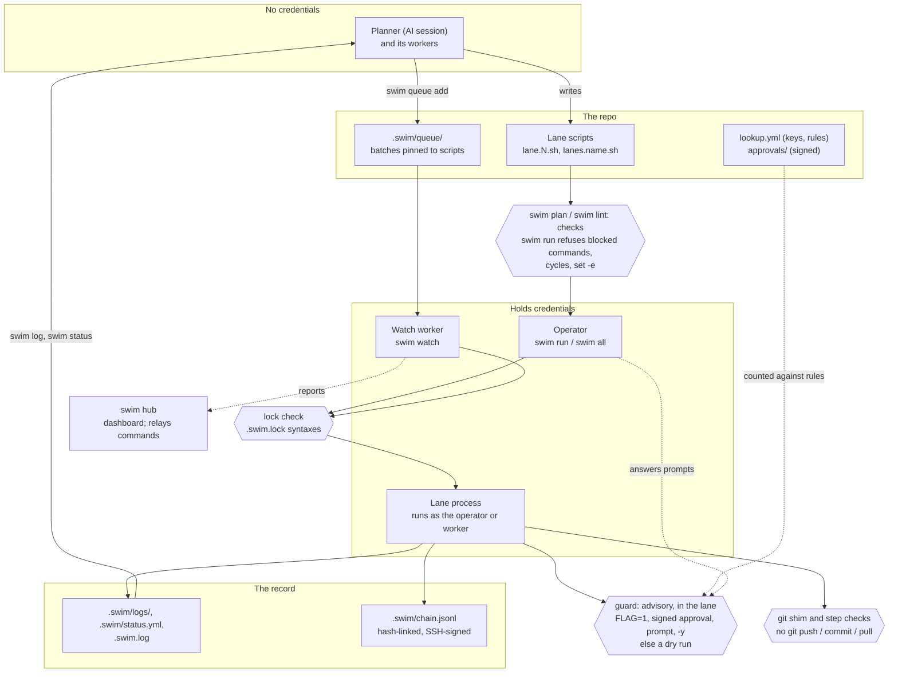

# swim

[](https://github.com/gates-brightly/swimlane/actions/workflows/test.yml)

**Sane AI ops.**

Run AI-written operational changes safely, with a human in the loop and a
provable record of what happened.

An AI session (the *planner*) and its subagents (the *workers*) write
operational work as small scripts (bash, Python, TypeScript, or any
program), one per numbered *lane*. A person
runs them with `swim`, in places the AI can't reach: a VPN-only account,
their own credentials, production. Every step, result and approval lands in
plain-text logs the AI reads back to decide what to do next.

> The session writes. The operator runs. The log reports.

```
swim · myrepo · main@64a0e07 · 0:04
 swim 1  PASS 0:01                  Diamond root: fetch pages              51c7cf2e
 swim 2  PASS 0:03                  Child A: convert to Markdown           d7af1473
 swim 3  / running 0:04             Child B: link stats                    0acffc31
 swim 4  / waiting on swim 3        Join: build report                     db8e71f9
──────────────────────────────────────────────────────────────────────────────────
[3] ==> compute stats.json
[3] $ e2etool stats
[3] PASS  compute stats.json  0.1s
```

swim is a flywheel for AI-assisted operations work: every round leaves a
log, a status and an archive behind, so the next round, session or person
picks up where the last one stopped instead of starting over.

### Quickstart

Five minutes, no cloud credentials: two harmless lanes in a scratch repo
([install](#install) swim first). Paste each block into a shell.

<!-- quickstart -->
```sh
mkdir swim-quickstart && cd swim-quickstart && git init -q
swim init                         # config entry, .gitignore block, .swim/status.yml
swim new 1 "Say hello"            # writes lane.1.sh from a template

# Replace the template with one harmless step:
cat > lane.1.sh <<'EOF'
#!/usr/bin/env bash
# swim: syntax 2
# Round: Say hello
_swim_lib=$("${SWIM_BIN:-swim}" lib) || exit 1; eval "$_swim_lib"
lane_init 1

stage check
run "say hello" echo "hello from swim"

summary
EOF

swim plan                         # what would run, without running it
swim run 1 --plain                # run it
swim log 1                        # the round, step by step
swim verify                       # check the chain of custody (signed if you have ~/.ssh/id_ed25519)
```

A destructive step goes behind a guard, and is a dry run until a person
approves it:

```sh
swim new 2 "Write hello.txt"
cat > lane.2.sh <<'EOF'
#!/usr/bin/env bash
# swim: syntax 2
# Round: Write hello.txt
_swim_lib=$("${SWIM_BIN:-swim}" lib) || exit 1; eval "$_swim_lib"
lane_init 2

stage check
run "nothing written yet" ls

stage change
if guard HELLO_ALLOW_WRITE "write hello.txt (quickstart)"; then
  run "write hello.txt" bash -c 'echo hello > hello.txt'
fi

summary
EOF

swim run 2 --plain --no-prompt             # SKIP: a dry run, nothing written
HELLO_ALLOW_WRITE=1 swim run 2 --plain     # approved up front: the step runs
cat hello.txt
swim history --oneline                     # the chain: rounds and the flag's approval, newest first
```
<!-- /quickstart -->

Without `--no-prompt` on a terminal, swim asks you instead: `swim 2
requires human approval of task: write hello.txt (quickstart) Y/N [N]`.

What you get:

- **The AI writes, but never needs your access:** no production
  credentials, VPN or authority. Only your machine, or a worker you
  control, runs anything.
- **Work survives the session:** scripts, status, queue and logs live in
  the repo, so a new session or another agent catches up with `swim log`
  instead of having everything explained again.
- **Nobody waits on anybody:** the AI queues the next batch while you're
  busy; you approve in batches or ahead of time, and a worker runs it.
- **Parallel lanes with dependencies:** independent rounds run at once, and
  dependent ones wait for the rounds they depend on.
- **Changes are dry runs until a person approves them:** destructive steps
  sit behind guards. You approve at the terminal, with a flag, or with a
  signed approval from a teammate somewhere else.
- **Logs both people and agents can read:** one plain-text format, readable
  with `cat` and parseable by an agent. Results go back to the AI as compact
  text, not output pasted into chat, so they cost little context.
- **A tamper-evident record:** every approval and every round is signed and
  hash-linked, so you can prove what ran and who approved it.
- **The same rounds from a terminal, a queue, CI, or many machines,**
  watched from one dashboard.

### What swim protects against

Approval, signing and the chain prove **who decided what**. They don't make
a script safe: an approved script does whatever it says, with the access of
whoever runs it.

- **In scope:** an AI that writes the work but holds no credentials; changes
  that are dry runs until a person approves them; approvals bound to the
  script's exact SHA-256, so an edit after approval voids it; a queued batch
  pinned to its scripts; and a hash-linked, signed record of every approval
  and round.
- **Bypasses are recorded:** `FLAG=1`, `-y` and `swim watch --approved`
  skip the question, and each leaves a record in the lane's log,
  `.swim.log` and the chain. What `-y` approved also shows in `swim
  status`, `swim history`, CI summaries and the hub.
- **Out of scope:** a malicious or mistaken script that is approved and run
  with broad credentials. Guards and lint are conventions, not a sandbox:
  use scoped credentials and OS isolation for that. A
  [guarded secret](#guarded-secrets) is the exception, for credentials
  that live only in swim's vault: a lane that skips its guard never gets it.
- **The approved bytes run:** each lane runs a staged, read-only copy of
  what its execution manifest pins (script, sourced files, sidecar, runner,
  policy), and an approval binds that manifest.
- **A chain you can believe:** `swim verify` says how far, in levels:
  consistent (links and signatures), trusted (signers pinned outside the
  repo in `trust.yml`), anchored (checkpoints sent to `chain_anchors`, so a
  chain truncated or re-signed wholesale is caught) and authorized (each
  approval met `lookup.yml`'s rule).
- **A lane can't approve itself:** under `swim run` the launcher decides
  every guard from what it saw as the run started, records each approval
  itself, and attests the run; a lane can't mark, stage or finish another
  lane's round.
- **Not yet:** lanes run as you, so one can still read the runner key;
  what it signs on its own fails `swim verify`. See
  [`tasks.md`](tasks.md).

The details, and the test behind each claim, are in the
[trust model](docs/trust-model.md).

### How it fits together



Credentials live only with the operator and the worker; the guard runs
inside the lane, so it is advisory. More in
[the architecture](docs/architecture.md).

The product brief is in [`swimlane.md`](swimlane.md). **AI agents** should
start with `swim --help`: it is the full guide for planners and workers.

### Install

swim is one Go binary (Go 1.27.1 or newer to build):

```sh
go install github.com/gates-brightly/swimlane/cmd/swim@latest
export PATH="$(go env GOPATH)/bin:$PATH"      # if ~/go/bin isn't on your PATH yet
swim --version                                # e.g. swim 0.20261014.1
```

More install options are under [Install and versions](#install-and-versions).

---

## Common usage patterns

Each pattern builds on the ones before it. Start with the first; reach for
the others when you need them.

### 1. Run a round yourself

```sh
cd your-repo
swim init                                  # config entry, .gitignore block, .swim/status.yml
swim new 1 "Cut over orders-api"           # writes lane.1.sh from a template
$EDITOR lane.1.sh                          # fill in the steps (or have an AI write them)
swim plan                                  # dry run: what would run, wait or be skipped
swim all                                   # run every pending lane, with a live view
swim log 1                                 # what happened, step by step
swim archive 1 && swim stub 1 "orders done"   # keep the log, free the lane for the next round
```

### 2. Let an AI plan, workers write, and you run

The planner splits the work into lanes and gives each worker one lane. Each
worker writes only its own `lane.N.sh`. You run `swim all` and the agents
read the results back:

```sh
swim report --earmark       # everything new since you last looked, in full, then mark your place
swim status                 # what every lane is doing (or: cat .swim/status.yml)
swim log 2                  # a lane's log; swim log <job-id> works too
swim log                    # .swim.log: one line per top-level action, for catching up
```

The conventions agents follow live in `swim --help`: which lanes to use,
never editing a running lane, gates before changes, and how to read results.

### 3. Run a DAG in parallel

A round declares what it waits for, and swim schedules it:

```bash
# After: 2 3        # in lane.4.sh: start once swim 2 and swim 3 have passed
```

```sh
swim plan           # the dependency tree, Terraform style
swim all --parallel 8
swim timeline       # who waited on whom, and the longest chain
```

### 4. Make a guarded change

Destructive steps sit behind a `guard`. With the flag unset, swim asks the
person at the terminal; with no one to ask, the step is a dry run:

```bash
if guard ORDERS_ALLOW_SST_REMOVE "remove SST stack orders-prod (tf owns it now)"; then
  run "sst remove" npx sst remove --stage prod
fi
```

```sh
swim run 2                                # asks: swim 2 requires human approval of guard ORDERS_ALLOW_SST_REMOVE ... Y/N [N]
ORDERS_ALLOW_SST_REMOVE=1 swim run 2      # approved up front (scripts, CI)
swim all -y                               # approve every question this run, logged as -y
```

### 5. Queue work and let a worker fire it

Get a batch ready while other work runs, then let it start as soon as swim
is idle:

```sh
swim queue 4 5 --approve ORDERS_ALLOW_SST_REMOVE --note "cutover batch"
swim watch                                # the worker: runs queued batches when idle
swim queue 6 --wait --timeout 30m         # queue, then block until it finishes (exit = its result)
swim wait                                 # block until nothing runs and nothing is queued
swim log 3f2a9c1e --until-done            # wait for one job; exits with its round's status
```

### 6. Approve from anywhere, as a team

Approvers sign the exact script, from their own machine, with their SSH key:

```sh
swim approve 4 --guards FIN_ALLOW_DROP    # approve lane 4's exact script; co-approvers run the same
swim approve --auto bob                   # standing approval: every job bob queues, for 30 days or until revoked
swim revoke --auto bob
swim watch --approved                     # run scripts as soon as they're fully approved
swim verify                               # prove the record hasn't been tampered with
swim history --oneline                    # who approved and ran what, like git log
```

`lookup.yml` says whose key is whose and how many approvals a guard needs
(see [Approvals](#approvals)).

### 7. Run rounds in CI

```sh
swim ci --changed --junit swim.xml        # only the rounds this push changed
```

Each lane's log gets its own foldable section, and failures become
annotations. See [CI](#ci).

### 8. Watch many workers from one place

```sh
swim hub --addr 0.0.0.0:7700 --token "$SWIM_HUB_TOKEN" \
  --tls-cert hub.crt --tls-key hub.key                            # the dashboard, over https
swim hub enroll https://hub:7700 --token "$SWIM_HUB_TOKEN"        # in each repo with a worker
swim watch                                                        # now reports to the hub
```

### 9. Drive swim from scripts and agents

Every read command has a versioned YAML form, and long waits have proper
exit codes:

```sh
swim run 1 2 --yaml           # a stream of events: start, step, finish, summary
swim status --yaml
swim log 2 --yaml             # the round parsed: steps, commands, output, results
swim plan --yaml
```

---

## Features

### Lanes, rounds and jobs

| Term | Meaning |
|---|---|
| **lane** | A numbered slot, `swim 1..99`, with one script (`lane.N.sh`, or `lane.N.py`, `lane.N.ts`, a binary `lane.N`, ...) and one log. One worker owns it at a time. |
| **round** | What a lane script holds: one goal ("cut over service X"). Disposable. |
| **job** | A round's unique id (its `# Job:` line). It's recorded everywhere, exported to steps as `$SWIM_JOB`, and usable wherever a lane number is: `swim run 3f2a9c1e`. Naming a job pins the run to that exact round, so a lane rewritten in the meantime is refused. |
| **step** | One command run through `run`, `gate` or `snapshot`, logged with its command, output and exit code. |
| **gate** | A step whose failure stops the round before any later (destructive) step. |
| **guard** | A named approval in front of a destructive step (below). |

### Lane scripts

`swim new` writes a template. A filled-in round:

```bash
#!/usr/bin/env bash
# swim: syntax 2
# Round:   Cut over orders-api from SST to Terraform
# Job:     3f2a9c1e-7b4d-4e2a-9c1e-7b4d4e2a9c1e
# After:   1
# Owner:   zach
# Guards:  ORDERS_ALLOW_SST_REMOVE  remove SST stack (tf owns it)
# Locks:   tf/orders
# Timeout: 30m
_swim_lib=$("${SWIM_BIN:-swim}" lib) || exit 1; eval "$_swim_lib"
lane_init 2

stage snapshot
snapshot "cfn template" aws cloudformation get-template --stack-name orders-prod
stage check
run  "tf plan" terraform -chdir=infra/orders plan -detailed-exitcode
gate "DeletionPolicy is Retain" bash -c 'aws cloudformation get-template --stack-name orders-prod | grep -q Retain'
stage change
if guard ORDERS_ALLOW_SST_REMOVE "remove SST stack orders-prod (tf owns it)"; then
  run "sst remove" npx sst remove --stage prod
fi
stage verify
run "re-plan is a no-op" terraform -chdir=infra/orders plan -detailed-exitcode
summary
```

- **Header:** only `Round` is required. Missing keys get defaults: a `Job`
  is generated when the round starts, and guards are found from `guard`
  calls in the body. Unknown keys are kept and shown in the log.
- **Stages:** every round uses the same four, in order: `snapshot`
  (read-only capture), `check` (checks and gates), `change` (guarded
  changes) and `verify` (prove it worked). Skip the ones you don't need.
  Running them out of order logs a `WARN`.
- **Time limits and retries:** `run`, `gate` and `snapshot` take
  `--timeout 2m`, `--retry 3`, `--backoff 5s` and `--retry-on 1,255` before
  the label. `# Step-Timeout: 5m` sets a default for every step, and the
  round's `Timeout` always wins. Only retry idempotent steps.
  - A limit stops everything the step started: each step runs in its own
    process group, which gets SIGTERM, then SIGKILL after 5s.
  - Except a step whose stdin is the terminal (a lone lane run from a
    terminal): it stays in the lane's group so it can read the keyboard, and
    a limit stops only its own process.
- **Library:** the functions are `lane_init`, `stage`, `run`, `gate`,
  `snapshot`, `guard`, `confirm`, `last_failed`, `any_failed`, `drift`,
  `stop` and `summary`. It runs on macOS's bash 3.2.
- **Failures:** a failed `run` doesn't stop the round; a failed `gate` does.
  Don't use `set -e`.
- **Native SDKs:** Python (`import swim`), TypeScript and Go libraries give
  lane programs swim's steps as calls, plus in-process steps for native
  checks (a `boto3` call logged as a step). They talk to the lane's socket
  (`swim.lane/v1`), and swim still decides everything. Local modules a lane
  imports are pinned with it; list them in `# Includes:`. See the [Python](docs/examples/python.md),
  [Node](docs/examples/node.md) and [Go](docs/examples/go.md) examples.
- **Approve the plan, not just the script:** `evidence "tf plan" terraform
  plan ...` in the check stage records what the change will do.
  `swim approve` shows it and signs its hash with the script, and the
  approval counts only while the run's plan still matches. If it drifted,
  the log shows a diff and the guard asks again.
- **Matrix rounds:** `# Matrix: SVC=orders,billing,users` runs one script
  once per value. Each cell has its own log, status and result.
  `# Matrix-Parallel: 2` runs cells two at a time, `swim run 3 --failed`
  retries only the failed cells, and `After: 3[orders]` waits for one cell.
- **Pre-approve in the live view:** select a lane that hasn't asked yet
  and press `y` (or `n`) to answer its guards ahead of time, then walk away.
  The answer is pinned to the script and lasts this run only.
- **Read-only preview:** `swim plan --check` runs every round's `snapshot`
  and `check` stages for real, stops where `change` would begin, and shows
  which gates pass today (`check PASS`, `stops at gate "..."`). Guards never
  approve, and lane status is untouched. `swim ci --check` does the same
  for a pull request.
- **Outputs between lanes:** `# Outputs: stats.json` promises files in
  `$SWIM_OUT`, and a dependent lane reads them with
  `"$(input 2 stats.json)"` (or `output KEY value` / `$(input 2 KEY)` for
  small values). Outputs are hashed into the chain on both sides, so
  `swim verify` proves the report was built from exactly those stats.
- **Status messages:** `msg --progress 7/25 "migrating billing"` (or
  `swim msg` from any language, even inside a step) shows where a long job
  is now, in the live view, `swim status` and the hub. The latest wins, and
  the log keeps throttled `MSG` lines.
- **Outcome handlers** (`# swim: syntax 3`): `on_success`, `on_failure` and
  `on_exit` functions run however the round ends, like try / catch /
  finally. They run soft, so every rollback step gets its attempt, and
  `reached change || return 0` skips a rollback when nothing changed. A
  failed round whose `on_failure` failed exits 89. `# Fail: hard` ends the
  round at the first failed step (`run --soft` opts one out), and
  `# Handler-Timeout:` (default 5m) is the handlers' budget. Lanes in other
  languages name commands: `# On-Failure: python3 rollback.py`.
- **Checks:** `swim lint` checks scripts before you run them: header,
  stages, guards, bash 3.2, blocked commands, and secrets echoed to the log.

### Jobs

Any lane can be split into jobs, numbered under the lane and nested to any
depth: `1.1`, `1.2`, `1.5.9.9`. The lane's header (`Round:`, `After:`,
`Locks:`) comes first, then each job starts at a `# swim job N.K` line with
its own header and steps:

```bash
#!/usr/bin/env bash
# swim: syntax 2
# Round: CI
# Code here (before the first job) runs in every job, after lane_init.

# swim job 1.1 -----------------------------------------------------------
# Round:  fmt
# Always: yes
gate "gofmt -s" bash -c 'test -z "$(gofmt -s -l .)"'

# swim job 1.2 -----------------------------------------------------------
# Round:  tests          (no steps: it groups the jobs under it)

# swim job 1.2.1 ---------------------------------------------------------
# Round:  unit
run "unit" go test ./...

# swim job 1.2.2 ---------------------------------------------------------
# Round:  e2e
run "e2e" go test ./internal/e2e/...
```

- **In order:** jobs with steps run one at a time in file order, and the
  first failure skips the rest of the lane. Each has its own log (`swim log
  1.2.1`, `.swim/logs/agent1.2.1.log`), status and job id; `swim status`
  shows the lane with its progress.
- **A job id names it and everything under it:** `swim run 1.2` runs 1.2.1
  and 1.2.2, `swim run 1.2.2` just that one, `swim run 1` the whole lane.
  `After: 1.2` waits for every job under 1.2 to pass (`After: 1` for the
  lane). `1[2]` works too.
- **Always per job:** `Always: yes` on a job covers the jobs under it. The
  other lanes in a run wait for the lane's Always jobs, not the rest of it,
  and `swim all` runs them every time, plus any job that hasn't passed.
- **Less ceremony:** swim loads its library and calls `lane_init` and
  `summary` for a job that doesn't, and runs the script it generates at
  `.swim/groups/lane.N.<job>.sh`. Edit the lane's file, never that script.
  A lane's hash (approvals, queue pins, the chain) is its file's.
- **In Python, TypeScript and Go:** mark jobs in the language's comments
  (`# swim job 1.2`, `// swim job 1.2`) with their headers. Each job runs
  the whole program, and the SDK's `jobs()` calls its function: keys are
  job ids (`"1.2"`) or places under the lane (`"2"`), and the closest wins,
  so `"1.2"` handles 1.2.1 and 1.2.2 unless they have their own. A job with
  jobs under it only groups them. `r.job` is the running job's id.

  ```python
  # Round: checks
  # swim job 1.1
  # Round: fmt
  # swim job 1.2
  # Round: lint
  import swim
  swim.jobs({"1.1": lambda r: r.gate("fmt", ["ruff", "format", "--check"]),
             "1.2": lambda r: r.gate("lint", ["ruff", "check"])})
  ```
- **Group files:** `lanes.<name>.sh` at the repo root is a lane of jobs with
  a name instead of a number (it's the lane its jobs name), for standing
  jobs worth committing. A lane in a group file can't also have a
  `lane.N.sh`, and `swim new` and `swim stub` refuse it.
- **Lint and CI:** `swim lint` reports findings at the file's lines (`swim
  1.2.1: ...`), and `swim ci --changed` counts a changed group file as a
  change to its lane.

### Lanes in other languages

A lane script can be any runnable: `lane.N.py`, `lane.N.js`, `lane.N.ts`, a
compiled `lane.N`, a plain bash script. `swim new 3 "<goal>" --lang py`
(or `js`, `ts`) writes a template.

Worked examples, each with the native SDK and with the plain CLI:
[Python](docs/examples/python.md), [Node (TypeScript and
JavaScript)](docs/examples/node.md) and [Go](docs/examples/go.md).

How swim runs it:

1. `lane.N.sh` runs with bash, as always.
2. A `#!` line wins, and swim asks nothing.
3. Otherwise, `runners:` for the extension: your own (saved per repo in
   your config) wins over the repo's committed `swim.yml`.
4. A compiled or executable file runs as itself.
5. The first time swim meets an extension with none of these, it looks up
   the usual runners on `PATH` and asks:

   ```
   swim: lane.2.ts is the first .ts lane here: it has no #! line, and no runner is set for .ts files.
     1) /usr/local/bin/tsx
     2) /opt/homebrew/bin/bun
   Run .ts lanes with /usr/local/bin/tsx? [Y/n, a number, or type a command]:
   ```

   It saves the answer as `runners.ts` for this repo. In CI, or under
   `swim watch`, nobody is there to ask, so the lane fails at start with the
   exact fix: a `#!` line, `swim config runners.ts tsx`, or
   `runners: {ts: tsx}` in `swim.yml`.

swim runs the program inside a wrapper. The wrapper opens and closes the
round, exports `SWIM_LANE`, `SWIM_JOB` and the rest, and keeps the git shim
in front. Steps are swim commands, so any language can call them:

```python
#!/usr/bin/env python3
# Round:  Rotate the orders bucket
# Guards: ORDERS_ALLOW_DELETE  delete the old bucket (2026-10-13: replaced)
import os, subprocess
def swim(*a): return subprocess.run([os.environ.get("SWIM_BIN", "swim"), *a]).returncode

swim("stage", "check")
swim("gate", "new bucket exists", "--", "aws", "s3api", "head-bucket", "--bucket", "orders-v2")
swim("stage", "change")
if swim("guard", "ORDERS_ALLOW_DELETE", "delete bucket orders (2026-10-13: replaced)") == 0:
    swim("run", "delete old bucket", "--", "aws", "s3", "rb", "s3://orders")
```

- **The commands:** `swim run|gate|snapshot "<label>" -- cmd`,
  `swim guard FLAG "<action>"` (exit 0 when approved), `swim stage NAME`,
  `swim drift "<what>"` and `swim stop "<why>"`.
- **Ending the round:** a failed gate, `swim stop`, a blocked `git push` or
  your Ctrl-C ends the program, even if it ignores the exit code; no later
  step runs.
- **No swim calls:** a program that never calls `swim run` is logged as one
  step, with its whole output (secrets masked) and a result from its exit
  code.
- **Header:** `#` or `//` comments. A binary, or any lane, can keep its
  header in a sidecar `lane.N.yml` instead, and the sidecar's keys win:
  `round`, `job`, `after`, `guards` (a map of flag to action), `locks`,
  `timeout`, `step-timeout`.

### Logs

Logs are plain text, readable with `cat`. Each line's start says what it
is, and command output is always fenced with `| `, so
`grep '^  FAIL' .swim/logs/agent2.log` finds every failure:

```
== ROUND 2026-10-09T12:00:00Z  job=3f2a9c1e-...  Cut over orders-api
   script: lane.2.sh | owner: zach | after: 1 | timeout: 30m | git: main@abc1234 | sha256: e91a058b9c06

-- stage check  12:00:02
  FAIL  tf plan (exit 2)                        3.1s  12:00:02
        $ terraform -chdir=infra/orders plan -detailed-exitcode
        | Error: ...
  STOP  gate failed: tf plan

== END FAIL  pass=1 fail=1 skip=0 drift=0  exit=1  3.6s  2026-10-09T12:00:04Z
   stages: snapshot PASS | check FAIL | change none | verify none
```

- **`swim log N`** renders a log on a terminal: colours, times relative to
  the round's start, and long output folded (`--full` expands it). Piped,
  or with `--raw`, it prints the file as is.
- **The step running now** isn't in the file until it ends. `swim log` adds
  it, with its output so far, as `RUNNING  <label> (in progress)`.
- **`swim log N -f`** follows a lane live, like `tail -f`.
- **`swim log N --until-done`** waits for the round to end, then exits with
  its status.
- **`.swim.log`** is the project log: one line per top-level action. A new
  agent reads it first, and `swim note "<text>"` adds decisions to it.

### The live view

While lanes run, a panel pinned to the top of the terminal shows each
lane's state and round; output scrolls underneath, prefixed `[N]`.

- **Keys** (more than one lane on a terminal):
  - `→`/`←` open one lane's log, and `Esc` goes back to all lanes.
  - `↑`/`↓`, `PgUp`/`PgDn` and `Home`/`End` scroll.
  - Type a number and press `Enter` to jump to that lane. `f` filters to
    running or failed lanes, and `?` shows help.
- **Approvals:** a banner names a lane that's waiting for you. `Enter`
  opens it with the question underneath, and `y` or `n` answers it there.
- **No terminal, or `--plain`:** output is plain prefixed lines.
- **`--yaml`:** output is a stream of YAML events instead (see
  [Scripting](#scripting-and-yaml)).
- **Chime:** `swim config chime on` rings the bell when a run ends, and
  when `swim watch` finishes each queued job; set it to `failure` to ring
  only when something went wrong.

### Dependencies, parallelism and locks

- **`# After: 2 3`** waits for those lanes to pass in this run, and skips
  the round if one fails. A job id waits for that exact round. Ordering that
  holds for every round can go in config `deps`. A cycle stops the run
  before anything starts.
- **`# Finally: 1 2 3`** waits for those lanes to end, however they end, and
  never skips: cleanup and run reports, the run's `after_script`. Running
  one of them pulls the finally lane in (`--no-finally` leaves it out), and
  it sees each outcome as `SWIM_FINALLY_<N>`. The first Ctrl-C doesn't stop
  it (`finally_timeout`). Its result never changes another lane's; a failed
  one fails the run, and with an ordinary lane failing too, the run exits
  89. In a lane of jobs, `# swim job 1.9 finally` runs after a failed
  sibling.
- **`--parallel N`** (or config `max_parallel`) caps how many lanes run at
  once. Lanes ready to start queue for a slot, longest chain first.
- **`# Locks: orders-table`:** lanes that share a lock never run at the same
  time, in either order. That holds within a run and across concurrent runs
  on the machine. A failure doesn't spread through a lock.
- **`# Always: yes`** makes a lane standing setup, like a CI
  `before_script` (lint, fmt, init). It never counts as passed: `swim all`
  runs it every time, first, and every other lane in the run starts only
  after it finishes. Lanes that name it in `# After:` need it to pass; the
  others start whatever its result. `swim run N` pulls in the Always lanes
  that N names, and no others. An Always lane waits only on other Always
  lanes, and `swim stub` and `swim archive` refuse it without `--force`.
- **`# Rerun-Children: yes`** (Always lanes only): `swim all` also reruns
  every lane downstream of this one, at any depth, even if it passed. That's
  a test suite written as rounds: lint first, then the tests again. `swim
  lint` warns about a guarded round under one (`rerun-guard`).

```
$ swim plan
[+] swim 1  Diamond root: fetch pages
├── [+] swim 2  Child A: convert to Markdown
│   └── [+] swim 4  Join: build report  wait [2,3]
└── [~] swim 3  Child B: link stats
    └── [+] swim 4 (shown above)

Plan: 3 to run, 1 to retry, 0 to rerun, 0 to skip.
```

With Always lanes, `swim plan` draws them first (`[*]`), says which passed
lanes they rerun, then the rest:

```
[*] swim 1  lint
└── [+/-] swim 2  unit  rerun (swim 1)
[*] swim 5  init
then, once swim 1, 5 finish (whatever the result):
[+] swim 4  report
```

`swim timeline` draws when each lane waited (on dependencies, a slot or a
lock), ran and finished. It marks the longest chain, and `--html` writes a
Gantt chart you can share.

### Env files

Lanes get non-secret context (`STAGE`, `AWS_PROFILE`, table names) from
`KEY=VALUE` files. swim parses them and never runs them as shell:

```ini
# ~/.config/swim/env.swim: general keys, then a section per repo
STAGE=dev
[repo ~/dev/orders]
AWS_PROFILE=orders-prod

# <repo>/.env.swim (git-ignored): a section per lane
[lane 2]
TABLE=orders-v2
```

- **Precedence:** the shell wins, then the lane's section, the repo's
  section, `env:` in the committed `swim.yml`, and the general keys.
- **No approvals from files:** a key that is a lane's guard flag (or matches
  a `lookup.yml` guard glob) stops the run before anything starts.
- **Masked and recorded:** file values are masked in logs. The round header
  lists the files that applied, and status and the chain record a hash of
  the env. A queued lane whose env changed since it was queued is skipped.
- **`swim env N`** shows what a lane gets and where each key comes from.
- **`.lane.N.rc` is deprecated.** A guard flag it sets no longer approves,
  and `swim doctor --fix` moves a plain one into `.env.swim`.

### Caches

A lane can keep a tool's download cache between rounds. It names the
preset and the lockfile the tool checks the cache against:

```bash
# Cache: terraform @infra/orders/.terraform.lock.hcl
# Cache: npm @web/package-lock.json
```

swim points the tool's own cache (`TF_PLUGIN_CACHE_DIR`, `npm_config_cache`,
`PIP_CACHE_DIR`, `GOMODCACHE`) at a per-repo directory under
`~/.cache/swim`, so `terraform init`, `npm ci`, `pip install` and `go mod
download` skip what they already have.

- **The cache never decides what runs.** Only download caches a tool checks
  are presets: Terraform against provider checksums, npm against integrity
  hashes, pip against `--hash` entries, Go against `go.sum`. The lockfile is
  required and pinned in the execution manifest, so changing it stales
  approvals. Installed trees (`node_modules`, `.terraform/`) aren't cached.
- **Yours alone:** every cache directory must be yours and mode `0700`; a
  `cache_dir` under `/tmp` gets your user id appended. Clones and worktrees
  of one repo share its cache, and other repos don't.
- **Safe in parallel:** two lanes' `terraform init` take turns (Terraform's
  plugin cache isn't safe for concurrent inits); everything else shares.
- **Bounded:** a run trims the repo's caches to `cache_max` (10GB), least
  recently used first. `swim cache ls`, `swim cache rm PRESET` and `swim cache
  prune --older 30d` manage them; `swim cache path --ci` gives a CI cache
  step its directory and keys.

An installed tree (`node_modules`, a virtualenv) nothing checks on use is a
**snapshot**: the lane saves it whole and restores it in a later round,
keyed by the files it was installed from.

```bash
# Cache: snap:web/node_modules @web/package-lock.json
cache restore web/node_modules || { run "npm ci" npm ci --prefix web && cache save web/node_modules; }
```

The key hashes the tree, its `@` files (pinned like lockfiles), the OS, the
architecture and any `--with` strings. A miss passes and returns 1; a key is
written once; an outcome handler never saves; a save from a round with
failed steps is marked, and its restores say so. A restored tree runs
unchecked, so every restore is recorded in the round's chain entry.

### Modules

A module is a small, versioned utility a lane calls as a step: assume a
role, clone at a commit, post to Slack. The lane declares it, and the
execution manifest pins its bytes, so an approval covers the module as it
covers the script:

```bash
# Modules: aws-session clone@1 notify
mod_env aws-session --profile orders-prod --role arn:aws:iam::123456789012:role/deploy
mod clone https://github.com/org/orders 3f2a9c1e0b7d4e2a9c1e0b7d4e2a9c1e0b7d4e2a "$SWIM_OUT/orders"
mod notify "#orders" "orders deploy: done (job $SWIM_JOB)"
```

- **Every call is a step**, logged, masked and timed like `run`. `mod_env`
  gives the lane what the module exports (credentials), masked from then on.
- **Built in:** `target` (stop unless the AWS account, kube context or GCP
  project is the one the lane says), `backup` (an RDS or DynamoDB restore
  point, waited for, its id recorded), `wait` (until an HTTP status, a TCP
  port, a command's exit code or a kube rollout says ready), `aws-session`,
  `clone` and `notify`.
- **Bash or Go**, built in or in the repo (`modules/<name>/`, `swim modules
  new`). Each has a `module.yml` that declares its effects (network,
  secrets, writes, credentials); `swim plan`, `swim approve` and lint show
  them. They're declared, not enforced: a module runs as the lane.
- **Pinned and allowed:** editing a module stales the approvals of lanes
  that use it, and `swim.yml` `modules: allow:` decides which modules lanes
  may use (built-ins only by default). A module is never fetched at run
  time.

### Secrets

Secrets live encrypted to your SSH key, not in env files or the shell:

```sh
swim secret set db_password            # this repo (hidden prompt, or stdin)
swim secret set datadog_api_key --all  # every repo
swim secret ls                         # names and scopes, never values
```

A lane gets them by name: from bash with the CLI, and from other
languages with the SDK:

```bash
DB=$(swim secret get db_password) || stop "no db password"   # check it: lanes don't run with set -e
```

```python
password = swim.secret.get("db_password")          # TypeScript: await secret.get(...)
                                                   # Go: swim.Secret.Get(...)
```

- **Encrypted with [age](https://age-encryption.org)** to an `ssh-ed25519`
  or `ssh-rsa` key (`secrets_key`, else `signing_key`, else
  `~/.ssh/id_ed25519`). They're kept in `secrets.yml` next to your config,
  mode 0600. Names stay readable; each value is encrypted on its own.
  Decrypting needs the private key on disk, because ssh-agent can't
  decrypt.
- **Two scopes:** `--all` and `--repo` (this git repo, the default inside
  one). A repo's own secret wins over an `--all` one with the same name.
- **Decrypted once per run:** `swim run` decrypts at start and serves the
  lanes over a private socket. It asks a protected key's passphrase before
  the live view, and only if a lane looks like it uses secrets. Outside a
  run, `swim secret get` and the SDKs decrypt with your key directly.
- **Masked exactly, by name:** every lane process masks every secret its
  lane may get as `***(db_password)`, including their base64 and URL
  forms, whichever ones it used. `swim run`'s own stream masks them all.
- **Audited:** `.swim.log` records which lane got which secret and how,
  never the value. `swim lint` warns about names the store doesn't have.
- **CI:** `SWIM_SECRET_<NAME>` stands in for a secret, with no key needed.
- **The limits:**
  - Secrets keep values out of logs, the hub and git. They don't protect
    against lane code, which runs as you and could read your key itself.
  - A value passed as a command argument (`psql "$DB"`) is visible in `ps`
    while it runs; prefer the tool's env variable or a file when it has one.
  - `swim watch` and CI can't ask a passphrase.

#### Guarded secrets

A secret can be guarded by a guard flag in the committed `swim.yml`. The
run hands it to a lane only after that lane's guard was approved in this
run, so a script that skips `guard` never gets the credential that makes
the destructive call possible:

```yaml
# swim.yml
secrets:
  PROD_DB_ADMIN_URL: { guard: ORDERS_ALLOW_DROP }                        # released after that guard is approved
  AWS_PROD_WRITE_ROLE: { guard: [INFRA_APPLY, INFRA_DESTROY], release: step }  # either one; handed out once
ambient_credentials: [prod-write]   # AWS profiles with the same access: lint and doctor point them out
```

```bash
if guard ORDERS_ALLOW_DROP "drop the orders table"; then
  export DATABASE_URL=$(swim secret get PROD_DB_ADMIN_URL) || stop "refused"
  run "drop table" psql -c 'drop table orders'    # psql reads DATABASE_URL: not on its command line
fi
```

- **Approvals that count:** the ones the launcher saw: the prompt (or the
  live view's pre-answer), `-y`, signed approvals, a queued batch's
  `--approve`, and `FLAG=1` in the environment `swim run` started with.
  `FLAG=1` a lane sets itself, or a `.lane.N.rc`, never counts.
- **Per lane, per run:** the approval is for that lane process: another
  lane, or the next run, asks again. It lasts until the lane exits;
  `release: step` hands the value out once and refuses a second get.
  `swim plan --check` never releases one.
- **Refused:** `refused: PROD_DB_ADMIN_URL is guarded by
  ORDERS_ALLOW_DROP, which isn't approved in this run`, as a `WARN` in the
  lane's log, in `.swim.log`, and a `secret-refused` chain entry. A release
  is a `secret-released` entry: the name, the flag, how it was approved and
  the approve entry it rests on (`swim verify` checks the run recorded
  it), never the value.
- **CI and the hub:** `SWIM_SECRET_<NAME>` of a guarded secret is kept out
  of lanes' environments; only the broker serves it. `swim secret grant
  --guard FLAG` guards a hub grant too (both guards must be approved).
- **Outside a run:** `swim secret get` of a guarded secret works at your
  own shell (recorded in `.swim.log`) and is refused in a lane run with
  bash.
- **The limits:** it protects only credentials that exist nowhere else.
  Ambient credentials (`~/.aws` profiles) are out of its reach: run with
  read-only ones and put write roles in the vault, for example as the
  credentials an `aws sts assume-role` step uses, so the elevated session
  exists only after approval. Released means usable: the lane can reuse
  the value however it likes. And with a secrets key that has no
  passphrase, a lane can decrypt `secrets.yml` itself (`swim run` and
  `swim doctor` warn).

### Guards and approvals

<a id="approvals"></a>

A `guard FLAG "<action>"` approves its step in one of these ways, in this
order:

1. **The flag is set.** `FLAG=1` approves up front, for CI and scripts.
   `FLAG=0` declines without asking. Under `swim run` the flag must come
   from the environment `swim run` started with (your shell, or a script
   that runs `swim run`): a lane that sets `FLAG=1` for itself gets a dry
   run, `FLAG=1 was set inside the lane, not in the environment swim run
   started with`.
2. **A signed approval.** Approvals of this exact execution manifest (see
   [below](#execution-manifest)), plus standing approvals for whoever queued
   the batch, are counted against `lookup.yml`'s rule for the guard.
3. **The person at the terminal** answers
   `swim 2 requires human approval of guard FLAG ... the lane says: <action>  Y/N [N]`.
   swim names the lane, job and manifest itself; the action is the lane's
   own words, labelled as such. A flag the script doesn't declare is
   refused. Questions from parallel lanes take turns, or wait on their lane
   in the interactive view.
4. **`-y`:** `swim all -y` (or `swim watch -y`) approves every question,
   and logs that `-y` did. `swim status` lists the guards under the lane
   (`approved without a prompt: DEPLOY (swim run -y)`), as do the round's
   chain entry, `swim ci`'s summary and the hub.

Anything else is a **dry run**: the step is skipped, and the log says how to
approve it. A queued batch never asks a question.

Under `swim run` the launcher, not the lane, decides all of this: it reads
`approvals/` and `lookup.yml` once, as the run starts (an approval signed
mid-run counts from the next run), and it writes each approval to the chain
itself. A lane can't record an approval of its own, and once the run ends
`swim verify` checks every approval against what the run recorded.

Signed approvals are files under `approvals/`. Commit them, so approvers can
add theirs from anywhere. Each file is an ordered, hash-linked log of SSH-signed
approve and revoke events, so its order is part of what it proves, like git
commits:

```sh
swim approve 4 --guards FIN_ALLOW_DROP     # this exact manifest (it lists what it pins); co-approvers run the same
swim approve --auto bob [--guards A,B]     # every job bob queues, until it expires (30d) or is revoked
swim revoke 4 / swim revoke --auto bob     # withdraw yours
swim approve                               # list approvals and who stands behind each
```

`lookup.yml` (committed at the repo root) says whose key is whose, groups
people, and sets what each guard needs:

```yaml
users:
  zach:  {keys: ["ssh-ed25519 AAAA... zach@laptop", "sk-ssh-ed25519@openssh.com AAAA... zach@yubikey"]}
  alice: {keys: ["ssh-ed25519 AAAA... alice@work"]}
  bob:   {keys: ["ssh-ed25519 AAAA... bob@ci"]}
groups:
  platform-admin: [zach, alice]
require:
  - guards: [FIN_ALLOW_*]
    group: platform-admin
    count: 2              # two different people from platform-admin
standing:
  max: 90d                # the longest a standing approval may last
```

Script approvals and standing approvals count together: zach's standing
approval of bob's jobs plus alice's approval of the script make two
platform-admins. If a script, or anything else its manifest pins, changes
after it was approved, the approval no longer matches it, and swim says why
(`stale: includes lib/orders.sh changed`). `swim keys` shows who's who.

Approvals have a lifecycle, and `swim approve` shows each one's state:
**active**, **expired**, **revoked**, **stale** (what it approves changed)
or **insufficient** (its signers don't meet the rule). A standing approval
lasts 30 days unless `--expires` says otherwise, never longer than
`standing: {max: 90d}` in `lookup.yml`, and binds the rule each guard had
when it was signed: change that rule, stricter or looser, and it stops
counting for that guard (a script approval binds every rule through its
manifest). Who is who is read live, so a key removed from `lookup.yml`
stops counting at once. A standing approval from before they expired keeps
counting, with a warning, until `lookup.yml` sets `standing.max`.

### Execution manifest

<a id="execution-manifest"></a>

Before a lane waits for anything, `swim run` pins what it will run and
stages a read-only copy under `.swim/runs/<run>/<N>/`. The lane runs that
copy, so editing the working tree afterwards (even mid-round) changes
nothing. The copy is checked again right before the lane starts. The
manifest pins:

- the script, and every local file it sources or imports (listed in
  `# Includes:` or found by a literal path; `swim lint` wants them listed,
  and refuses `source "$x"`, which can't be pinned)
- its sidecar, and how it runs (`bash`, its `#!` line, a `swim.yml` runner)
- the policy keys of `swim.yml` (blocked commands, runners, approvals,
  signing, secret masking, `env`) and `lookup.yml`'s `require:` rules

Approvals sign the manifest's hash. The env files' values and the runner
binary differ from machine to machine, so they're recorded and checked for
the run but not signed. Facts swim can't pin, like the cloud account or which
`terraform` is on `PATH`, can be declared as probes. Each probe is read when
a guard is approved and again just before it returns, and a difference ends
the round as drift:

```bash
# Observe: aws_account = aws sts get-caller-identity --query Account --output text
# Observe: path terraform aws
```

Probes narrow the gap between approval and use; they don't close it.

### Chain of custody

Every approval and every round is recorded in `.swim/chain.jsonl`, one entry
per line. Each entry is signed with the runner's SSH key and holds the
SHA-256 of the entry before it:

- **round:** the script's and manifest's hashes, the hash of the round's log
  section, the result, and the approvals it used. A copy of each script
  that ran is kept by hash under `.swim/scripts/`, and the run's staged
  copy under `.swim/runs/` (`swim doctor --fix` prunes old ones).
- **approve:** who approved which guard of which script and manifest, and
  how: a signature, standing approval, prompt, flag, `-y`, or a queued
  batch.

```sh
swim verify                 # consistent, trusted, anchored, authorized: one line each (exit 1 if one says no)
swim history                # the chain, newest first, like git log (--oneline, -n N, --reverse)
swim chain repair           # remove a half-written last entry left by a crash (kept in a .bak, recorded)
swim keys trust --sign      # trust.yml: the keys verify trusts, pinned outside the repo
swim chain checkpoint       # sign the chain's head and send it to chain_anchors now
swim chain export --to file:/mnt/audit/orders   # copy the entries there too
```

`swim verify` reports levels, each saying what it rests on:

```
consistent  yes  418 entries, links and signatures match; logs, scripts and approvals as recorded
trusted     yes  2 signers, all in trust.yml (pinned 2026-09-30)
anchored    yes  extends checkpoint seq 412 (2026-10-14T09:12:00Z) from file:/mnt/audit/orders; 6 entries since
authorized  yes  31 approvals, each met its lookup.yml rule
note: anchoring proves this history existed by 2026-10-14T09:12:00Z; it doesn't prove the scripts were safe, nor anything about entries after it.
```

- **trusted:** `trust.yml` (committed) lists the runner and approver keys.
  Its hash is pinned in your `~/.config/swim/trust-pins.yml` the first time
  verify sees it (or `swim keys pin`; CI passes `--trust-pin`). A change
  counts only when signed by a key it already trusts
  (`swim keys trust KEY --sign`). A chain re-signed wholesale with a new
  key fails here.
- **anchored:** `chain_anchors: ["file:/path", hub]` in `swim.yml` sends a
  signed checkpoint of the chain's head at the end of every run, CI job and
  watch batch. Entries removed from the end, or a chain replaced, after a
  checkpoint left the machine fail here; `swim verify --against DEST`
  checks against an exported copy, even after the repo is gone.
- **authorized:** each approval met `lookup.yml`'s rule for its guard
  (`signed: true` on a rule also fails prompt and `FLAG=1` approvals).
- `--yaml` has each level as a field (`swim.verify/v1`), for CI.

Editing a log, removing an entry or reordering entries is caught and
reported. Signing uses `ssh-keygen -Y`, the same format git uses for SSH
commit signing, so anyone can check a signature without swim. Config:
`signing_key` (default `~/.ssh/id_ed25519`; a `.pub` path signs through
ssh-agent) and `signing: auto | required | off`.

Entries have no size limit, and each is synced to disk as it's written. If
a write is cut short (a crash, a kill, a full disk), the last line has no
newline, and swim refuses to append after it until you run
`swim chain repair`. That moves the partial line to
`.swim/chain.tail-<time>.bak`, truncates the chain after its last complete
entry, and appends a signed `repair` entry recording the removed bytes' size
and SHA-256. Complete entries are never touched.

### Queue, watch and wait

```sh
swim queue add 4 5 --approve FLAG [-y] [--note "..."]   # or: swim queue 4 5 ...
swim queue                                               # waiting, running, orphaned, done
swim queue show|rm|requeue ID
swim watch [--once] [-y] [--approved] [--no-tui]         # the worker
swim watch --headless [--detach|--status|--stop]        # the worker with no terminal
swim wait [--timeout D]                                  # block until idle and nothing queued
```

- **A batch is fixed when you queue it:** each lane is pinned to its job and
  its exact script. A lane edited afterwards is skipped, not run.
  Approvals travel with the batch, and the worker's own environment
  approves nothing.
- **The batch is signed by whoever queued it,** so standing approvals for
  that person apply to it.
- **`swim schedule 1 3 22:00 --approve FLAG`** queues a batch that a
  worker starts no earlier than 22:00 (a maintenance window, after
  hours): pinned and approved now, signed with its start time. Batches
  queued after it that depend on its lanes wait for it. The reply says
  the time in your zone and UTC, and warns when no `swim watch` runs to
  start it.
- **`swim watch`** runs queued batches side by side, then consumes each
  into `.swim/queue/done/` with its result.
  - **A batch starts once its lanes are free:** none in another batch or
    another swim run. Oldest first, but a later batch whose lanes are free
    starts ahead of one that has to wait. Up to `--batches N` at once
    (`watch_batches`, default 4); `--batches 1` runs one at a time.
  - **The screen stays up** while batches run, with each in the queue list;
    Enter on one follows its output, and Enter on a running lane follows
    that lane's log. `l` shows the highlighted lane's logs (every round in
    its current log), or a batch's lanes' logs, whether or not they run.
    Under the queue, the screen streams the latest output of every running
    lane; `o` hides it.
  - **Several workers** can share one queue. Claiming an entry is atomic,
    and workers pick batches under a lock, so two never take the same
    lanes. A batch renews a heartbeat in its entry (`queue_lease`, default
    2m), so from another host a dead worker's batch shows as orphaned.
  - **Ctrl-C** stops the batches in hand gracefully.
  - **`--approved`** also queues scripts as soon as they're fully approved.
  - **On a terminal,** the watch lists every lane's job and the queue while
    it waits. Use ↑ ↓ to pick one, `r` to run it now (a job as `swim run N`,
    a waiting batch out of turn) and `q` to queue a job. A batch's live view
    lets ← → pick a lane to read, but never answers its guards.

### Running unattended

```sh
swim watch --headless                        # foreground: under systemd, docker or tmux
swim watch --headless --detach               # background; pid in .swim/headless.pid
swim watch --headless --status | --stop
swim watch --headless --install systemd      # or launchd: writes a user unit, prints how to enable it
swim watch --headless --uninstall
```

- **`--headless`** is the same worker with no terminal: no screen, and it
  never reads stdin. It needs the directory enrolled with a hub
  (`swim hub enroll`), which marks it headless on its page.
- **One per repo.** `.swim/headless.lock` holds the worker's pid; a second
  `--headless` exits 2 and names it.
- **`--detach`** starts it in its own session. Its output goes to
  `.swim/headless.log`, rotated at 10 MiB with 3 kept. `--stop` sends it
  SIGTERM, but only after checking that the pid is still `swim watch
  --headless` and still holds the lock.
- **Signals:** SIGTERM stops it after the batch in hand, like Ctrl-C. SIGHUP
  only reopens its log, for logrotate; a running lane carries on.
- **`--install systemd|launchd`** writes
  `~/.config/systemd/user/swim-<id>.service` or
  `~/Library/LaunchAgents/com.swim.<id>.plist`, where `<id>` is the repo
  directory's name plus a hash of its path. The unit pins swim's path, the
  repo, `PATH` and `SWIM_USER`, restarts on failure, and allows `term_grace`
  plus 30s to stop. swim prints the `systemctl`/`launchctl` command (and
  `loginctl enable-linger`) but never runs it. `-y` in a unit needs
  `--i-mean-it`.
- **Commands from the hub:** a headless worker long-polls its hub for what
  hub users send: interrupt a lane, drain (stop after the batch in hand),
  run a lane, upload a run's log. The worker, not the hub, decides. It takes
  each command once (the hub's epoch, last seq and recent ids are kept in
  `.swim/hub.yml`), lets it expire after `headless.command_ttl` (10m;
  interrupt 2m), takes only what `swim.yml` allows, and refuses a command
  whose pin no longer holds (the run, or the script and manifest, the page
  showed). A run from the hub is queued unsigned, by `hub:<user> via <url>`,
  with no approvals of its own. A log is masked again before it goes.
  Every command, refused or not, lands in `.swim.log` and the chain.
- **Guards answered through the hub:** a guard nothing else approves (no
  signed approval, no flag the batch approves, no `-y`) shows on the
  worker's hub page as a question, and the lane waits up to
  `headless.answer_timeout` (30m) for an answer:
  - **Signed** (the default): `swim approve --hub WORKER/QUESTION`, or
    *Sign an answer* on the page (`ssh-keygen -Y sign` the statement it
    shows, paste the signature). The statement names the question, the
    worker, lane, job, run, script, manifest, evidence, guard, decision
    and expiry. The worker builds it from its own facts and checks the
    signature against `lookup.yml`, counting signers until the guard's
    rule is met. A hub that forges, replays or redirects an answer fails
    that check. Recorded as `hub-signed`, with the signatures.
  - **Button** (`headless.approvals: hub`): a hub operator's *Approve*
    counts as their answer, if `lookup.yml` lists them, for guards no
    `require:` rule names and that need no evidence. Recorded as
    `hub-button` (unsigned); `swim doctor` warns about the setting.
  - **No answer is a decline:** the deadline, the round's Timeout, the hub
    gone or the worker stopping all make the guard a dry run.

```sh
swim approve --hub billing/3f9c2a          # sign an answer to the question on billing's page
swim approve --hub billing/3f9c2a --decline
```

```yaml
# swim.yml (only swim.yml: config.yml can't set it)
headless:
  allow: [answer, interrupt, drain, log]   # the default; add run, trash, pause, unpause to allow them
  logs: on                                 # off: logs never leave this machine
  command_ttl: 10m
  approvals: signed                        # or hub: a listed operator's button click, where no require: rule names the guard
  answer_timeout: 30m
```

### Interrupts

- **First Ctrl-C:** every lane stops at its next step boundary. Running
  steps finish, nothing new starts, and lanes waiting to start are skipped.
- **Second:** interrupts the running steps, and kills them after
  `interrupt_grace` (5s). The kill reaches everything a step started.
- **Third:** kills them at once.
- **Other signals:** SIGTERM (a CI cancel) stops gracefully, then forces
  after `term_grace`. `swim interrupt N` stops one lane from another
  terminal.

### Safety

- **swim never pushes, commits or pulls.** `git push`, `git commit` and
  `git pull` are caught three ways, and the round stops:
  - in a script, before the lane starts;
  - in a command built at runtime, at the step (`BLOCKED`, exit 87);
  - by a git shim on each lane's `PATH`.
  
  A repo can block more commands with `blocked_commands`.
- **Secrets are masked** as `***` everywhere swim writes. That covers the
  values of `secret_env` variables and of names like `*_TOKEN`, plus
  credential shapes such as AWS key ids and GitHub tokens. Secrets from
  [`swim secret`](#secrets) are masked exactly, as `***(name)`. It's a
  backstop: still never print secrets.
- **Fail-closed:** gates and `confirm` stop the round when there's no
  answer.
- **Running lanes are protected:** swim won't edit, archive, stub or rerun a
  lane that's running.
- **Environment check:** `swim doctor` checks the setup: binary, `PATH`,
  config, `.gitignore`, stale pid files, toolchain and lock.

### CI

<a id="ci"></a>

`swim ci` is `swim all` for a CI job:

- It never prompts.
- Each lane's log goes in a foldable section.
- FAIL and DRIFT become annotations, and so does a guard approved with no
  one asked (by a guard flag the job set, or `-y`).
- It writes a job summary, plus an optional JUnit report.

It detects GitHub Actions and GitLab CI, and falls back to generic output.
Commit a `swim.yml` with the repo's settings (the same keys as a config
`repos:` entry), and the lane scripts the job runs.

```yaml
# .github/workflows/swim.yml
jobs:
  swim:
    runs-on: ubuntu-latest
    steps:
      - uses: actions/checkout@v4
        with: { fetch-depth: 0 }          # --changed needs the history
      - run: go install github.com/gates-brightly/swimlane/cmd/swim@latest
      - run: swim ci --changed --junit swim.xml
        env:
          FIN_ALLOW_DELETE: ${{ secrets.FIN_ALLOW_DELETE }}   # guard flags come from the job
      - uses: actions/upload-artifact@v4
        if: always()
        with:
          name: swim
          include-hidden-files: true
          path: ".swim/logs\n.swim.log\nswim.xml"
```

`--changed` runs only the rounds whose script the push or merge request
changed, plus any unpassed lanes they wait on (Always lanes count as
unpassed). `--rerun` runs passed rounds again; for a test suite written as
rounds, an Always lane with `Rerun-Children: yes` at its root does that
without the flag. A fresh CI checkout has no passed rounds, so everything
runs there either way. swim never commits results back.

This repo dogfoods it. Its own CI is `swim ci` over five committed group
files, so the slow suites run side by side. Lane 1
([`lanes.ci.sh`](lanes.ci.sh)) runs fmt, lint, unit tests and race first,
as Always jobs. Then e2e (lane 2, `lanes.e2e.sh`), fault injection (3),
the security suite (4) and fuzzing (6) start together, each its own lane so
a red run names the gate. A run takes about as long as the slowest suite.
`make ci` runs the same lanes locally.

### The watch hub

```sh
swim hub [--addr 127.0.0.1:7700] [--token T]          # serve the dashboard (and a live screen on a terminal)
swim hub --addr 0.0.0.0:7700 --tls-cert C --tls-key K   # serve it to the network, over https
swim hub enroll URL --token T [--name billing] [--ca hub.crt]   # in a repo; then swim watch reports to it
swim hub status | leave
swim hub login URL --admin-token T [--ca hub.crt]    # the operator, once
swim hub approve billing                             # or press a on its row in the hub's screen
swim secret grant billing db_password                # encrypted here to billing's key; the hub keeps ciphertext
swim hub user add alice --role operator              # a person: token shown once; viewer or operator
```

- **Dashboard:** a card per worker, showing its activity, lanes and queue.
  Workers that stop reporting show as stale.
- **Live screen:** on a terminal, `swim hub` lists every worker with the
  selected one's running lanes and queue. Enter opens a worker to show each
  lane's message and log tail, and Esc comes back. `--no-tui` turns it off.
- **Worker pages:** each lane's step, the live tail of running lanes, the
  queue, and recent events.
- **`GET /api/workers`:** the same data as JSON.
- **Push, not pull:** workers report to the hub, so they can sit behind NAT.
  A restarted hub fills back up as workers report.
- **Access:** workers need the token. Viewing the pages needs no login, so
  the hub binds to localhost by default.
- **Users:** `swim hub user add NAME --role viewer|operator` (the admin)
  prints a token, once; the hub keeps its hash. The user logs in at
  `/login` for a 12-hour session (`HttpOnly`, `SameSite=Strict`, `Secure`
  under TLS, a CSRF token on every form), or sends the token as a bearer
  token. On a headless worker's page they get controls: **Interrupt**,
  **Stop after this batch**, **Run now** (operator), **Log** (viewer
  too), and for a guard waiting for an answer **Sign an answer** (viewer
  too: the signature is what counts), **Approve** (operator, where the
  worker takes button answers) and **Decline** (operator). The page shows each command's outcome as the worker acknowledges
  it. Uploaded logs stay in the hub's memory only (8 MiB a log, 64 MiB in
  all, 15 minutes). The admin token manages users and sends no command.
- **TLS:** `--tls-cert`/`--tls-key` serve https (TLS 1.2+), reloading the
  certificate when its files change. Without them the hub refuses any
  non-loopback `--addr` (exit 2) unless you pass `--insecure`; behind a TLS
  proxy, keep the hub on 127.0.0.1. `enroll` and `login` refuse `http://`
  to another machine unless `--insecure`, and `--ca FILE` trusts a
  self-signed certificate or private CA (saved with the enrollment).
  `swim doctor` warns about an existing plain-http enrollment.
- **Secrets for workers:**
  - **Keys:** enrolling gives each worker its own age key (with no
    passphrase, so `swim watch` can decrypt unattended) and a token of its
    own. A worker stays *pending* until you approve its key fingerprint on
    the hub.
  - **Grants:** `swim secret grant` encrypts a secret on your machine to
    that worker's key. The hub keeps only ciphertext, in `--state DIR`, and
    never holds a key that could decrypt it.
  - **At run time:** the worker's runs fetch and decrypt their grants at
    start. Lanes get them the usual way (`swim secret get`, `secret.get`),
    masked by name. A grant made with `--guard FLAG` is a
    [guarded secret](#guarded-secrets) there.
  - **Changes:** `swim secret revoke` removes a grant. A worker that comes
    back with a new key drops to pending and loses its grants. The hub's
    `audit.log` records approvals, grants and fetches.

### Scripting and YAML

<a id="scripting-and-yaml"></a>

| Command | YAML schema |
|---|---|
| `swim run\|all --yaml` | `swim.run/v1`: one document per event (`run`, `waiting`, `queued`, `locked`, `start`, `step`, `finish`), then `summary`. `--yaml-output` adds lane output. |
| `swim status --yaml` | `swim.status/v1` |
| `swim log N --yaml` | `swim.log/v1`: the round parsed, including the running step as `RUNNING` |
| `swim plan --yaml` | `swim.plan/v1` |
| `swim timeline --yaml` | `swim.timeline/v1` |
| `swim history --yaml` | `swim.history/v1` |
| `swim queue --yaml` | `swim.queue-list/v1` |
| `swim lint\|doctor --yaml` | findings |

Schemas only grow within a version; removing or renaming a field bumps it.
Exit codes are dependable: `0` means everything selected passed. Waits
(`swim wait`, `queue --wait`, `log --until-done`) exit with the result
they waited for.

---

## Reference

### Docs

- [Trust model](docs/trust-model.md): what swim protects against, what it
  doesn't, and the test behind each claim.
- [Architecture](docs/architecture.md): where credentials live and where
  policy is enforced.
- [State machines](docs/state.md): lane, job, queue entry, run record and
  approval states.
- [Recovery](docs/recovery.md): orphaned queue entries, stuck lanes, a
  failing `swim verify`, a lost key, a lock mismatch.
- [Compatibility](docs/compatibility.md): platforms, prerequisites,
  versions and stability tiers.

### Commands

| Command | What it does |
|---|---|
| `swim init` | Set up the repo: config entry, `.gitignore` block, `.swim/status.yml`. |
| `swim new N "<goal>" [--lang py\|js\|ts] [--job ID]` | Write `lane.N.sh` (or `.py`, `.js`, `.ts`) from the template with a new job id. |
| `swim plan [N\|JOB ...] [--rerun] [--yaml]` | Dry run: what would run, retry, rerun or be skipped, as a dependency tree. |
| `swim all [--rerun] [--parallel N] [-y\|--no-prompt] [--no-tui] [--yaml]` | Run every pending round that hasn't passed. |
| `swim run N\|JOB ...` / `swim N ...` | Run specific lanes, even if they passed. A job id pins the exact round. |
| `swim status [N\|JOB] [--yaml]` | Last state of every lane. |
| `swim log [N\|JOB] [--all] [--full] [--raw] [--yaml] [-f] [--until-done]` | A lane's or job's log (with the running step), or the project log. |
| `swim timeline [RUN\|N\|JOB] [--steps] [--yaml] [--html FILE]` | When each lane waited, ran and finished; the longest chain. |
| `swim archive N\|JOB ... [--as NAME] [--force]` / `swim stub N "<msg>" [--force]` | Archive lanes' logs (all or nothing); replace a script with a "nothing pending" stub. An Always lane needs `--force`. |
| `swim clean [--all] [-n]` / `swim clean --restore STAMP` | A clean slate, nothing deleted: archive every finished lane at once, then (asked, default no) remove waiting batches and move the lane scripts aside. |
| `swim prune --older D [--logs] [--confirm]` | Delete leftovers past a cutoff for good (moved-aside scripts, consumed queue entries, old run stages, archived logs with `--logs`), recorded in the chain. |
| `swim trash N\|JOB` / `swim trash --restore STAMP` | Move one lane out of the way, recoverably: its script to `.swim/cleaned/`, its log archived (`d` in `swim watch`, the hub's Trash button). |
| `swim note [--lane N] "<text>"` | Record a decision in the project log. |
| `swim queue [add\|show\|rm\|requeue]`, `swim queue N ... [--approve F] [-y] [--wait] [--timeout D]` | Queue batches to run once their lanes are free. |
| `swim schedule LANES... TIME [--approve F]`, `swim schedule list\|rm ID` | Queue a batch that starts no earlier than TIME (`13:30`, `1:30pm`, `tomorrow 06:00`, `+2h`). |
| `swim watch [--once] [-y] [--approved] [--no-tui]` | The queue's worker; on a terminal, pick a job to run (`r`) or queue (`q`). |
| `swim watch --headless [--detach\|--status\|--stop\|--install systemd\|launchd\|--uninstall]` | The worker with no terminal, in the background or as a service. |
| `swim wait [--timeout D]` | Block until nothing runs and nothing is queued. |
| `swim approve [N\|JOB --guards A,B \| --auto USER]` / `swim revoke ...` | Signed approvals: this exact script, or standing for a user's queued jobs. |
| `swim approve --hub WORKER/QUESTION [--decline]` | Sign an answer to a guard waiting on a headless worker. |
| `swim verify [--strict] [--against DEST] [--yaml]` / `swim history [--oneline]` / `swim chain repair\|checkpoint\|export` / `swim keys [trust\|pin]` | The chain of custody: prove it (in levels), read it, repair a cut-short write, checkpoint and export it, and see and pin who's who. |
| `swim hub [enroll\|leave\|status]` | The watch hub. |
| `swim ci [N\|JOB ...] [--changed[=BASE]] [--rerun] [--junit FILE]` | Run rounds in a CI job. |
| `swim interrupt N\|JOB` | Stop one lane at its next step boundary. |
| `swim claim N` | Hold a lane while this session writes its round (`swim new` does it): another session's `new`, `stub` and `archive` refuse the lane until it runs, is released, or the lease (2h) runs out. Set `SWIM_SESSION` per session. |
| `swim pause N\|JOB` / `swim unpause N\|JOB` | Hold a running lane before its next step without ending it (its process, approvals, slot and locks kept); `swim resume` is the same as unpause. `--all` holds every lane and stops workers claiming batches. |
| `swim lint [--strict]` / `swim doctor [--fix]` | Check lane scripts / the environment. |
| `swim config [KEY [VALUE]] [--repo]` | Show or set config, keeping the file's comments. |
| `swim env [N\|JOB] [--yaml]` | The env a lane gets from env files, masked, with each key's source. |
| `swim secret set\|get\|ls\|rm NAME [--all\|--repo]` | Secrets encrypted to your SSH key, for lanes. |
| `swim cache [ls\|rm PRESET\|prune --older D\|path --ci]` | The tool caches lanes keep between rounds (`# Cache:`). |
| `swim lock [--upgrade]` / `swim changelog` | The repo's syntax lock; what changed between versions. |
| `swim step -- cmd ...` / `swim lib` | Run and log one command; print the lane library. |
| `swim run\|gate\|snapshot "<label>" -- cmd`, `swim guard\|stage\|drift\|stop ...` | In-lane steps for lane scripts in any language. |
| `swim --help` / `swim <cmd> --help` | The full guide, or one command's detail. |

### Files

| Path | Contents | Commit? |
|---|---|---|
| `lane.N.sh` (or `lane.N.<ext>`, `lane.N`) | Lane N's current round. | Usually not; yes for CI rounds. |
| `lane.N.yml` | Optional metadata for lane N's script (a binary's header). | With its script. |
| `swim.yml` | The repo's shared settings. | Yes |
| `lookup.yml` | Users, keys, groups and approval rules. | Yes |
| `approvals/` | Signed approvals. | Yes |
| `.swim.lock` | The syntax versions the repo's lanes use (script, log, state). | Yes |
| `.swim.log` | The project log: one line per top-level action. | No |
| `.env.swim` | Lane-scoped env (`[lane N]` sections). | No |
| `~/.config/swim/secrets.yml` | Your secrets, encrypted (`swim secret`). | Never |
| `~/.cache/swim/<repo>-<hash>/` | Tool caches lanes keep between rounds (`# Cache:`, `cache_dir`). | Never |
| `.swim/status.yml` | Last state of every lane (`cat` it). | No |
| `.swim/logs/` | Lane logs, current and archived. | No |
| `.swim/chain.jsonl`, `.swim/scripts/` | The chain of custody, and every script that ran. | No (export it to keep it) |
| `.swim/queue/`, `.swim/runs/`, `.swim/snapshots/` | Queued batches, run records and each run's staged lane copies, snapshot output. | No |
| `.swim/hub.yml` | This directory's hub enrollment. | No |
| `.swim/headless.lock`, `.pid`, `.log` | A headless worker's lock, pidfile and own log (`swim watch --headless`). | No |

### Config

Personal settings live outside the repo, so workers can't change them:

```yaml
# ~/.config/swim/config.yml  ($XDG_CONFIG_HOME/swim/config.yml)
defaults:
  header_env: [STAGE, AWS_PROFILE]       # env recorded in every step header (never secrets)
  chime: failure                         # true | false | failure
  approvals: prompt                      # prompt | flags (never ask)
  interrupt: graceful                    # graceful | immediate
  signing_key: ~/.ssh/id_ed25519.pub     # signs the chain and approvals (a .pub: via ssh-agent)
  secrets_key: ~/.ssh/id_ed25519         # swim secret encrypts to it (the private key must be on disk)
repos:
  /path/to/your-repo:                    # overrides defaults and the repo's swim.yml
    max_parallel: 8
    secret_env: [DATADOG_API_KEY]
    deps: {2: [1], 4: [2, 3]}
    runners: {ts: /usr/local/bin/tsx}    # saved when swim asks; swim.yml's runners: are the default
```

There is no lane count to configure: swim shows the lanes in use (a lane
script that isn't a stub, a current log, or a running lane). `swim new N`
starts one, and `swim archive N` (with a stub or no script) drops it.

`swim config KEY VALUE` sets a value and keeps the file's comments. A
committed `swim.yml` takes the same keys as a `repos:` entry, and it's how a
CI runner with no config gets its settings.

### Install and versions

<a id="install-and-versions"></a>

```sh
go install github.com/gates-brightly/swimlane/cmd/swim@latest     # or @v0.20261014.1 to pin
git clone git@github.com:gates-brightly/swimlane.git && cd swimlane && make install   # from a checkout
make link / unlink    # symlink this checkout's bin/swim into ~/.local/bin
make which            # every swim on your PATH, and which one runs
swim changelog        # what's new in the version you're running (--since <old version>)
```

- **Version numbers:** `swim --version` prints `0.<YYYYMMDD>.<index>`:
  the release's date and its number that day (tag `v0.<YYYYMMDD>.<index>`).
  The version says nothing about compatibility; syntax versions do.
- **Syntax versions:** lane scripts and logs declare their syntax
  (`# swim: syntax 2`), and swim's state files (status, the chain, the
  queue, approvals) have one too. Older files are migrated automatically,
  with the originals kept under `.swim/migrations/`.
- **`.swim.lock`:** the first run in a repo writes it, pinning the script,
  log and state syntax the repo uses. Commit it. A swim with other syntaxes
  refuses to run lanes, and says whether to update swim or run `swim lock
  --upgrade`. Releases that change no syntax never touch it.
- **Platforms and stability:** Linux and macOS, no Windows. What each
  runtime needs, which outputs are stable, and how deprecations are
  announced: [compatibility](docs/compatibility.md).

### Development

```sh
make test             # unit tests (fast)
make e2e              # the Go e2e suite and every scenario (S="dag99 ..." for some)
make check            # gofmt, vet, unit and e2e tests
make ci               # this repo's CI rounds, through swim ci
make next-tag                         # tag HEAD with the next release tag (today's date, the day's next index) and push it; DRY=1 prints it
make release V=v0.<YYYYMMDD>.<index>  # tag it (checks the date, index, CHANGELOG, clean tree; never pushes)
```

- **Two layers of end-to-end tests:**
  - `internal/e2e` (Go) checks commands one at a time.
  - `e2e/scenarios` runs whole lane DAGs offline: 99 lanes, injected
    failures, retries, interrupts, locks and CI. See
    [`e2e/README.md`](e2e/README.md).
- **Security regression suite:** `internal/e2e/security_test.go`
  (`go test ./internal/e2e -run TestSecurity -v`) holds the audit's
  checklist, one subtest per case: no approval, a declined or timed-out
  one, an approval for another script, a script edited after approval, the
  chain's record of a round, and secrets kept out of logs. A known gap is a
  subtest that skips with `gap: T<n>`, naming the task in `tasks.md` that
  closes it; finishing that task replaces the skip with the real check.
- **Testing crashes and concurrency:**
  - **Fault injection:** `go test ./internal/e2e -run TestFault` builds a
    second swim with `-tags swimfailpoint` and crashes it at named points
    (`internal/failpoint` lists them: mid-step, mid-claim, mid-write,
    mid-append), then checks what a restart makes of the state. Set
    `SWIM_FAILPOINT=<point>:kill|pause` on that binary to try one by hand.
  - **Many workers:** `TestFaultManyWatchers` runs four `swim watch`
    processes on one queue.
  - **Scheduler properties:** `TestSchedulerProperties` runs random lane
    graphs (`SWIM_QUICK_COUNT=100` for more).
  - **Fuzzing:** `go test ./internal/logparse -fuzz FuzzParse` (also
    `FuzzParseScript` in `internal/lane`, `FuzzDecodeLine` in
    `internal/chain`, `FuzzLaneRequests` in `internal/cli`). A crash the
    fuzzer finds lands in that package's `testdata/fuzz`; commit it with
    the fix.
  - **State transitions:** with `SWIM_CHECK_STATES=1` (set by both e2e
    suites) an illegal `status.yml` transition panics; see
    [state machines](docs/state.md).
- **Bash 3.2:** `internal/assets/lib.sh`, `e2e/run.sh` and
  `e2e/lib/common.sh` must stay compatible with macOS's bash 3.2.
- **Incompatible changes:** bump the syntax version of what changed
  (`Script`, `Current` for logs, or `State` in `internal/syntax`), add it to
  `swim lock --help` and `CHANGELOG.md` (with Upgrading notes), and follow
  the release steps at the top of the changelog.
