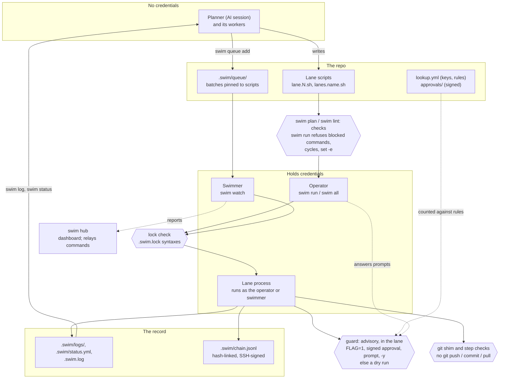

# Architecture

How a round gets from an AI session to a signed record, where credentials
live, and where policy is enforced.

[← back to the README](../README.md#how-it-fits-together) ·
[Trust model](trust-model.md) · [State machines](state.md)

Read it top to bottom:

1. **The planner and its workers write.** They hold no credentials. Each
   worker writes one lane script in the repo; the planner can queue batches.
2. **swim plan and swim lint check the scripts.** `swim run` refuses to
   start on blocked commands (`git push`, `git commit`, `git pull`,
   `blocked_commands`), dependency cycles, `set -e` and a missing
   `lane_init`. `swim lint` also warns about a delete or drop outside an
   `if guard` block, but nothing stops it.
3. **A person runs it, or a swimmer does.** The operator runs `swim run` or
   `swim all` with their own credentials. A queued batch is pinned to its
   exact scripts, and `swim watch` runs it with the swimmer's credentials;
   the swimmer's environment approves nothing.
4. **The lock check.** A swim whose syntax versions differ from the repo's
   `.swim.lock` refuses to run lanes.
5. **Guards ask for approval.** A guard asks the launcher, which approves
   with `FLAG=1` (set in `swim run`'s own environment), signed approvals
   counted against `lookup.yml` (as they were when the run started), the
   person at the terminal, or `-y`, in that order; anything else is a dry
   run. The launcher records each approval in the chain, and attests the
   run when its last lane exits. The guard runs inside the
   lane's own process, so it is advisory: a script that skips it isn't
   stopped, except from a guarded secret: the run's secrets broker
   releases one only to a lane whose guard of it the launcher approved.
   See the [trust model](trust-model.md).
6. **The git shim and step checks** refuse `git push`, `git commit` and
   `git pull` however a lane calls git.
7. **The record.** Each step lands in the lane's log, its state in
   `.swim/status.yml`, each top-level action in `.swim.log`, and each
   approval and round in the hash-linked, signed chain.
8. **The planner reads it back** with `swim log` and `swim status`, and
   writes the next round.

The **hub** is a side path: swimmers push their status, lanes and queue to
it, and it serves a dashboard. Hub users can also send headless swimmers
commands (interrupt, drain, run, fetch a log, answer a waiting guard),
which the swimmers poll for, check against their own committed `headless:`
settings, carry out and record. An answer approves only when the swimmer
verifies it: an approver's SSH signature over the swimmer's own statement
of the question, against `lookup.yml`, or where `swim.yml` allows a
button. The hub never runs anything itself.

## Where credentials live

- **Cloud credentials, VPN, production access:** the operator's shell, or
  the swimmer's environment. Lanes inherit them, so every lane in a run can
  use them.
- **The runner's SSH key** (`signing_key`): on the machine that runs the
  rounds. It signs the chain.
- **Approvers' SSH keys:** on their own machines. Their public keys are in
  the committed `lookup.yml`.
- **`swim secret` values:** encrypted to your SSH key on disk, decrypted at
  run start, served to the run's lanes.
- **The planner:** none. If it runs as your OS user, it can reach what you
  can; isolate it if that matters.

## Where policy is enforced

| Point | Enforced by | Strength |
|---|---|---|
| Blocked commands | `swim run` before a lane starts, the step at run time, the git shim on `PATH` | Enforced for those commands (a text match); other ways to change a remote, like an API call, aren't covered |
| Lint | `swim lint`, and `swim run`'s preflight | `swim run` refuses `set -e` and `lane_init` errors; every other finding, like `destructive`, is advice |
| Lock | `swim run`, `swim all`, `swim new`, a lane run directly | Enforced |
| Queue pins | `swim watch` before a lane starts | Enforced; the stage and the pins are checked again right before the lane's process starts |
| Guard | `guard` in the lane process | Advisory |
| Approval rules | `swim run`'s launcher, from `approvals/`, `lookup.yml` and its environment as they were when the run started | Enforced for every guard a lane calls; the launcher records each approval, and `swim verify` fails on one it didn't |
| Chain | `swim verify` | Detects edits (consistent); re-signing with a key outside the pinned `trust.yml` (trusted); truncation or replacement after a checkpoint left the machine (anchored, with `chain_anchors`) |
