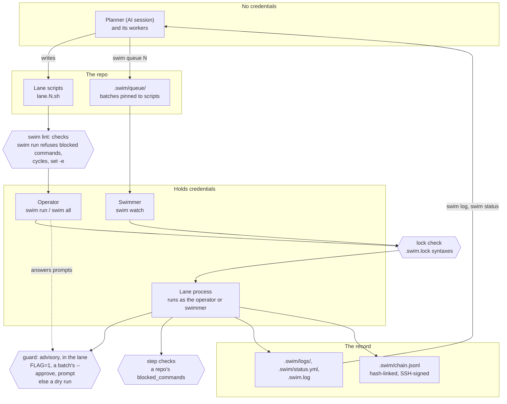

# Architecture

How a round gets from an AI session to a signed record, where credentials
live, and where policy is enforced.

Read it top to bottom:

1. **The planner and its workers write.** They hold no credentials. Each
   worker writes one lane script in the repo; the planner can queue batches.
2. **swim lint checks the scripts.** `swim run` refuses to
   start on a repo's `blocked_commands` (none by default), dependency cycles, `set -e` and a missing
   `lane_init`. `swim lint` also warns about a delete or drop outside an
   `if guard` block, but nothing stops it.
3. **A person runs it, or a swimmer does.** The operator runs `swim run` or
   `swim all` with their own credentials. A queued batch is pinned to its
   exact scripts, and `swim watch` runs it with the swimmer's credentials;
   the swimmer's environment approves nothing.
4. **The lock check.** A swim whose syntax versions differ from the repo's
   `.swim.lock` refuses to run lanes.
5. **Guards ask for approval.** A guard asks the launcher, which approves
   with `FLAG=1` (set in `swim run`'s own environment, or a queued batch's
   `--approve`), or the person at the terminal (or on `swim watch`'s
   screen), in that order; anything else is a dry
   run. The launcher records each approval in the chain, and attests the
   run when its last lane exits. The guard runs inside the
   lane's own process, so it is advisory: a script that skips it isn't
   stopped. See the [trust model](trust-model.md).
6. **Step checks** refuse a repo's `blocked_commands` at run time. swim
   blocks no command by itself: lanes may run git and gh.
7. **The record.** Each step lands in the lane's log, its state in
   `.swim/status.yml`, each top-level action in `.swim.log`, and each
   approval and round in the hash-linked, signed chain.
8. **The planner reads it back** with `swim log` and `swim status`, and
   writes the next round.

## Where credentials live

- **Cloud credentials, VPN, production access:** the operator's shell, or
  the swimmer's environment. Lanes inherit them, so every lane in a run can
  use them.
- **The runner's SSH key** (`signing_key`): on the machine that runs the
  rounds. It signs the chain.
- **The planner:** none. If it runs as your OS user, it can reach what you
  can; isolate it if that matters.

## Where policy is enforced

| Point | Enforced by | Strength |
|---|---|---|
| Blocked commands | `swim run` before a lane starts, the step at run time | Only a repo's `blocked_commands` (a text match); none by default |
| Lint | `swim lint`, and `swim run`'s preflight | `swim run` refuses `set -e` and `lane_init` errors; every other finding, like `destructive`, is advice |
| Lock | `swim run`, `swim all`, `swim new`, a lane run directly | Enforced |
| Queue pins | `swim watch` before a lane starts | Enforced; the stage and the pins are checked again right before the lane's process starts |
| Guard | `guard` in the lane process | Advisory |
| Approvals | `swim run`'s launcher, from its environment as it was when the run started, or the operator | Enforced for every guard a lane calls; the launcher records each approval, and `swim verify` fails on one it didn't |
| Chain | `swim verify` | Detects edits: a changed, removed or reordered entry, log or kept script. Not a chain re-signed wholesale, or cut short at its end |
