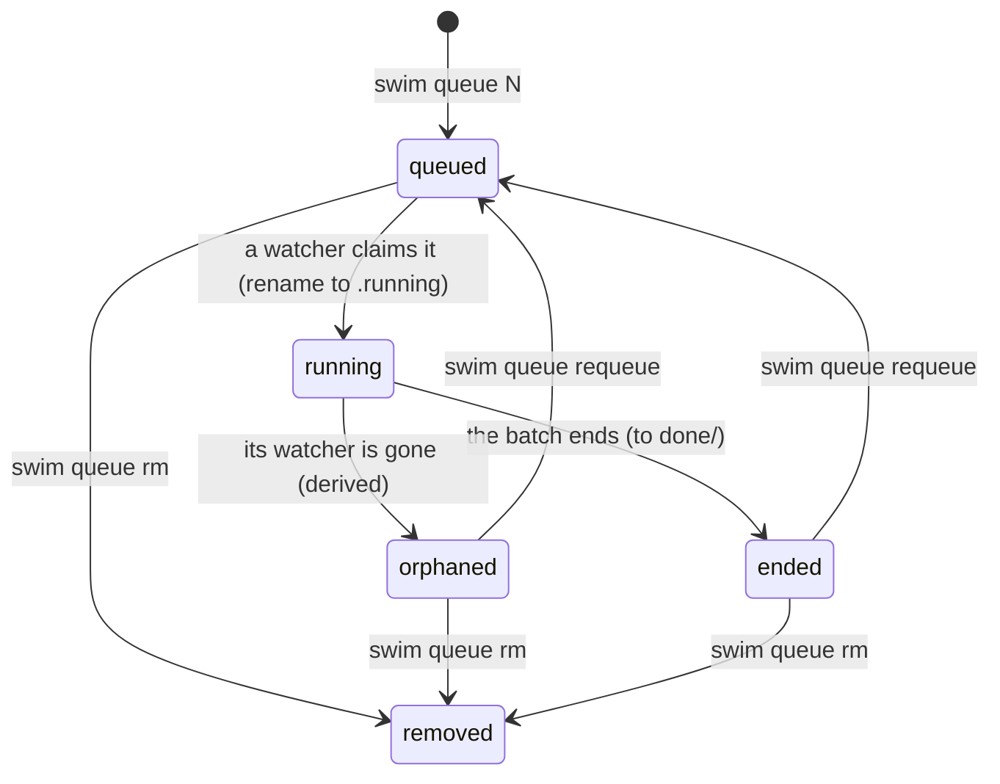

# State machines

The states swim records for a lane and a queued batch, and what moves
each. The code is the source of truth; each section names where.

## Lane

A lane's state is `state:` in `.swim/status.yml` (`swim status`), one of
the nine [lane states](concepts.md#lane-states) (`internal/status`). The
launcher, the lane's own hooks (`lane_init` and `summary`) and a few
commands write it. A `status.yml` an older swim wrote (`idle`, `pending`,
`locked`, `done`, ...) reads as the state each now is.

```mermaid
stateDiagram-v2
  [*] --> empty
  empty --> ready: swim new, or a round on disk
  ready --> empty: swim archive, or the script loses its round
  ready --> queued: swim queue
  queued --> waiting: a watcher takes the batch
  queued --> skipped: the script or env changed since it was queued
  ready --> waiting: selected, with dependencies, a lock held elsewhere, or no free slot
  ready --> running: lane_init
  waiting --> running: its turn, lane_init
  waiting --> skipped: a dependency failed or was skipped, or the run was interrupted
  running --> passed: exit 0
  running --> skipped: exit 0, a guarded step dry-ran
  running --> failed: a failed step or gate, any other exit
  running --> interrupted: Ctrl-C, swim interrupt, a signal, or its process gone
  passed --> empty: swim archive
  failed --> empty: swim archive
  skipped --> empty: swim archive
  interrupted --> empty: swim archive
```

| State | Entered when | Leaves when |
|---|---|---|
| `empty` | `swim init`, `swim archive` (the stub carries its note), or a script with no `# Round:` line | A round is written. |
| `ready` | `swim new`, or `swim status` reading a round on disk | The lane is run, queued or archived. |
| `queued` | `swim queue` (bare swim and swim watch show it from the queue) | A watcher takes the batch. |
| `waiting` | The launcher, before the lane starts: `waiting_on` names the lanes in its `After:`, `reason` the lock or slot. A running round asking the operator shows `waiting for approval: ...` while the file says `running`. | Its dependencies end, it takes its lock or a slot, or the run is interrupted. |
| `running` | `lane_init`, in the lane's process | `summary`, or the process exits. |
| `passed` | `summary`: exit 0, every guard it reached approved | The lane runs again, or is archived. |
| `failed` | `summary`: a step or gate failed or the exit was non-zero; or the launcher refused to start it (a blocked command, no runner) | As `passed`. |
| `skipped` | The launcher (it never started), or `summary` for a round that dry-ran a guard (`reason: dry run: <step>`) | As `passed`. |
| `interrupted` | `summary` on exit 129, 130, 137 or 143; or, for a lane whose process is gone, the next `swim run`, `all`, `ci` or `watch` (or `swim status --rebuild`) | As `passed`. |

Every write of `status.yml` goes through `status.Transition`
(`internal/status/transition.go`), which holds:

- **A running round only ends:** `passed`, `failed`, `skipped` or
  `interrupted`, never back to `waiting`, `ready` or `empty`.
- **A lane waiting for its turn** (`queued`, `waiting`) moves on or ends,
  never back to `ready` or `empty`.
- **An ended round's result never changes in place:** the ended states
  turn into one another only as a new round (another start time or run).
  A failure never becomes a pass.
- At rest (`ready`, `empty`, or ended) anything may follow.

An illegal move panics in tests and where `SWIM_CHECK_STATES=1` (both e2e
suites set it); elsewhere the write goes through, since refusing would
leave a lane stuck. `swim status --rebuild`, which rebuilds every entry
from the logs, is the one unchecked writer.

Who holds a lane:

- **A running lane** is held by `lane_init` under a lock on
  `.swim/laneN.claim` (pid, process start time, host). Of two processes
  starting one lane, exactly one gets it, and a reused pid doesn't hold
  it. A lane held on another host (a laptop and a container sharing the
  repo) is never taken for dead here: `swim status` shows `running ... on
  <host>`, and only that host's swim reaps it.
- **A lane whose process died** without a trap (SIGKILL, a closed
  terminal, a reboot) stays `running` in the file; `swim status` shows it
  `interrupted (its process is gone)`, and the next `swim run`, `all`, `ci`
  or `watch` ends its round: the cut-off step recorded as failed, `END
  INTERRUPTED` (exit 137) in the log, a round entry in the chain. See
  [recovery](recovery.md#a-lane-stuck-running).
- **A lane being written** has a session claim, `.swim/claims/lane.N.yml`,
  from `swim new` (`swim lint` refreshes it, `claim_lease`). It is not a
  state: it makes another session's `swim new` and `archive` refuse the
  lane (`--force` takes it over) and ends when the lane runs, is archived
  or expires.

## Queue entry

A queued batch is one file under `.swim/queue/`, and its name is its state
(`internal/queue`). Moves are renames, which are atomic, checked by
`queue.Transition` (`internal/queue/transition.go`).

| State | File | Notes |
|---|---|---|
| `queued` | `NNNN-q-<utc>-<hex>.queue` | Requeue puts it at the back with a new number. |
| `running` | `NNNN-....running`, with `worker:` (host, pid, start time, heartbeat, lease) | Of two watchers racing, one rename succeeds. The heartbeat is renewed every third of `queue_lease` (default 2m). |
| `orphaned` | the same `.running` file | Derived, never written: on the watcher's host its process is gone; from another host its heartbeat is older than its lease. Never run again on its own. |
| ended | `done/NNNN-....yml`, with `result:` | Passed, failed or interrupted alike; `swim queue` shows the result. A half-run batch is never retried on its own. |
| removed | none | `swim queue rm`; refused while `running`. |
