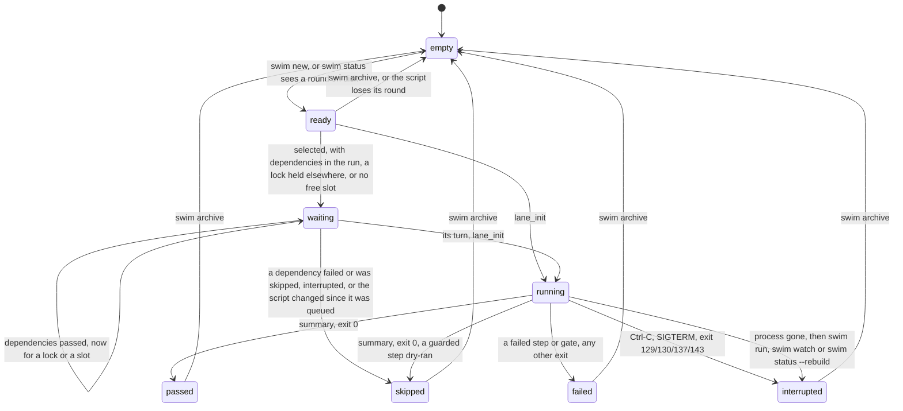
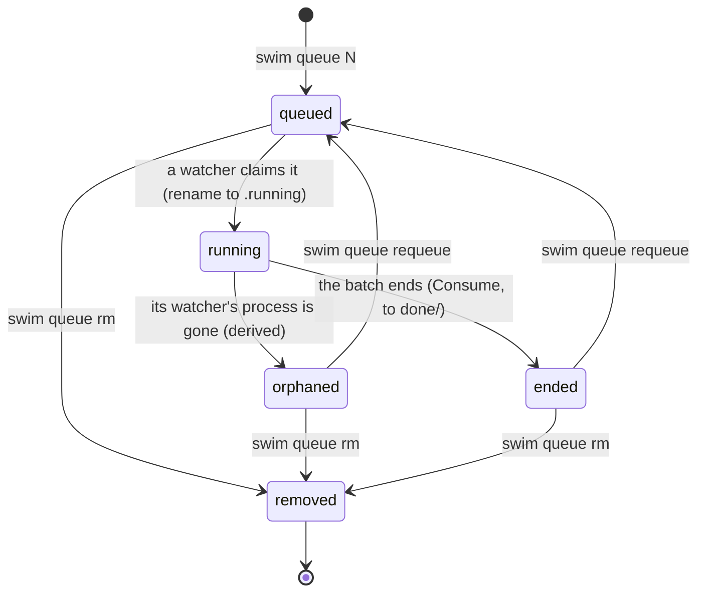

# State machines

Every state swim records, and what moves it from one to the next. The
code is the source of truth; each section names where.

Every write of `.swim/status.yml` goes through one check,
`status.Transition` (`internal/status/transition.go`), against the lane
rules below. An illegal move panics in tests and wherever
`SWIM_CHECK_STATES=1` is set (both e2e suites set it); elsewhere the write
goes through, since the file is the last known state and refusing would
leave a lane stuck. `swim status --rebuild`, which reconstructs every entry
from the logs, is the one writer that isn't checked. Queue entries are
checked too, under the same switch: every move of a queue entry's file
goes through `queue.Transition` (`internal/queue/transition.go`; an
illegal move is refused even where it doesn't panic).

## Lane

A lane's state is `state:` in `.swim/status.yml` (`swim status`). The
states are in `internal/status`; the launcher (`internal/launcher`), the
lane's own hooks (`lane_init` and `summary`, through `internal/cli/hooks.go`)
and a few commands write them.

The words are the lane states every view uses ([concepts](concepts.md#lane-states)):
`ready`, `queued`, `waiting`, `running`, `passed`, `failed`, `skipped`,
`interrupted`, `empty`. A status.yml an older swim wrote says `idle`,
`locked`, `pending`, `done` and the like: each reads as the state it now is
(`idle` is `empty`, `locked` is `waiting`, `pending` is `ready`, `done` is
`passed`), and the next write says the new word.

What the check enforces (`Transition`) for a lane:

- **A running round only ends:** `running` goes to `passed`, `failed`,
  `skipped` (it dry-ran a guarded step) or `interrupted` (or to `running`
  again, a new `lane_init`), never back to `waiting`, `ready` or `empty`.
- **A lane waiting for its turn** (`queued`, `waiting`) moves on or ends,
  but never goes back to `ready` or `empty`.
- **An ended round's result never changes in place:** `passed`, `failed`,
  `skipped` and `interrupted` turn into one another only as a new round
  (another start time or run id). A failure never becomes a pass.
- At rest (`ready`, `empty`, or its round ended), anything may follow: a
  new round, an archive, a refusal, a skip.

| State | Meaning | Entered when | Leaves when |
|---|---|---|---|
| `empty` | No round in the slot (a new lane, a stub, or no `# Round:` line). | `swim init`, `swim archive` with a stub, `swim status` | A round is written (`ready`), or the lane is run directly with bash. |
| `ready` | A round is written and hasn't run. | `swim new`, or `swim status` reading the script on disk | The lane is selected in a run, or archived. |
| `queued` | Its batch is queued (`swim queue`); bare swim and swim watch show it from the queue. | `swim queue` | A watcher takes the batch. |
| `waiting` | Selected in a run and held up, with why in `waiting_on` (lanes it names in `After:`) or `reason` (`waiting for lock orders-db: lane 4`, `waiting for a slot (#2)`). A running round that asks the operator is shown waiting (`waiting for approval: ...`) while it stays `running` in the file. | The launcher, before the lane starts | Its dependencies end, it takes its locks or a slot, or the run is interrupted. |
| `running` | Its process is running the round. | `lane_init` (in the lane's process) | `summary`, or the process exits. |
| `passed` | The round ended with exit 0, and every guarded step it reached was approved. | `summary`, or the launcher if the process died before `lane_init` | The lane runs again, or is archived. |
| `failed` | A step or gate failed, the round exited non-zero, or swim refused to start it (a blocked command, no runner). | `summary`, or the launcher | As `passed`. |
| `interrupted` | Stopped by a signal, or its process vanished. | `summary` on exit 129, 130, 137 or 143; for a lane with no live process, the next `swim run` (`all`, `ci`) or `swim watch` (`ReapDead`, exit 137), or `swim status --rebuild` | As `passed`. |
| `skipped` | Didn't do its work: it never started (a dependency failed or was skipped, the run was interrupted before it started, or a queued script or env changed since it was queued), or it ran to the end but dry-ran a guarded step (`reason: dry run: <step>`). | The launcher, or `summary` for a dry run | As `passed`. |

Notes:

- **A lane run directly** (`bash lane.N.sh`) goes from whatever it was
  straight to `running`.
- **A lane is claimed** by `lane_init` under a lock on
  `.swim/laneN.claim`, which records the process's pid, start time and
  host; `.swim/laneN.pid` holds the bare pid. Of two processes starting one lane
  at once, exactly one gets it. A lane counts as running only while that
  pid is alive with that start time, so a pid the kernel has since given
  to another process doesn't hold the lane (a pid file from an older swim,
  with no matching claim, falls back to the pid alone).
- **A lane claimed on another host** (two machines sharing the repo, such
  as a laptop and a container mounting it) counts as held: this machine
  can't see that process, so it never takes it for dead. It doesn't reap
  it, start it again, or remove its pid file (`swim doctor --fix`); that
  host's swim does. `status.yml` names the host too (`host:`), and `swim
  status` shows `running ... on <host>`. If that machine is gone for good,
  remove `.swim/laneN.pid` and run `swim status --rebuild`.
- **A lane whose process died** without a trap (a closed terminal,
  SIGKILL, a crash, a reboot) stays `running` in the file, and `swim
  status` shows it as `interrupted (its process is gone)`, until the next `swim run`, `swim all`,
  `swim ci` or `swim watch` starts: each first ends such rounds as the
  launcher ends a killed lane's (`launcher.ReapDead`): the cut-off step
  is recovered as failed, the log gets `END INTERRUPTED` (exit 137), the
  chain a round entry, and the lane is `interrupted`. `swim status
  --rebuild` does the same for status alone. A new run of the lane isn't
  blocked either way. See [recovery](recovery.md#a-lane-stuck-running).
- **A claimed lane** (`swim new` takes it; `swim lint` refreshes it) has
  a lease in `.swim/claims/lane.N.yml` (owner, session, host, created,
  expires, round id) while a session writes its round. It isn't a lane state:
  it guards `swim new` and `archive` from other sessions (`--force` takes
  it over, logged as `claim-broken`), and ends when the lane starts
  running, is archived, or expires (an expired one is removed by the next
  command that reads it). `swim status` shows it only to other sessions. Changes are
  serialised by `flock` on `.swim/claims/.lock`.
- **Passed lanes** are left alone by `swim all` (unless `--rerun`). `swim
  run N` reruns them.

## Queue entry

A queued batch is one file under `.swim/queue/`, and its name is its state
(`internal/queue`). Moves are renames, which are atomic.

| State | File | Entered by | Notes |
|---|---|---|---|
| `queued` | `NNNN-q-<utc>-<hex>.queue` | `swim queue N`, `swim queue requeue` | Requeue gives a new sequence number, at the back of the queue. |
| `running` | `NNNN-....running`, with `worker:` (host, pid and start time, user, heartbeat, lease) | `swim watch` claims it (the first waiting batch it can run, or `r` on a batch in the watch screen) | Of two workers racing, exactly one rename succeeds. The worker renews `heartbeat` every third of its `lease` (`queue_lease`, default 2m) while the batch runs. |
| `orphaned` | the same `.running` file | Not written: `swim queue` derives it. On the watcher's host: its pid is gone, or now another process (start time). From another host: its heartbeat is older than its lease | A claim by an older worker (no heartbeat) can't be judged from another host and stays `running`. Never run again on its own. |
| ended | `done/NNNN-....yml`, with `result:` | `Consume`, when the batch ends: passed, failed or interrupted alike | `swim queue` shows its result (`passed`, `failed`, ...) as its state. A half-run batch is never retried on its own. |
| removed | none | `swim queue rm` | Refused while `running`. |

`swim queue requeue` refuses a `queued` entry (already waiting) and a
`running` one (stop that watcher first). `queue.Transition` holds every move
to the diagram: consuming an entry no watcher claimed, consuming one twice,
or claiming a consumed one is a bug, and panics under `SWIM_CHECK_STATES`.

## Approval

An approval isn't a file: it's decided when the guard asks (the flag, a
queued batch's `--approve`, the operator) and recorded as an
`approve` entry in the chain. **Live-view answers** (`y` / `n` ahead of a
prompt) are pinned to the script and last one run.
