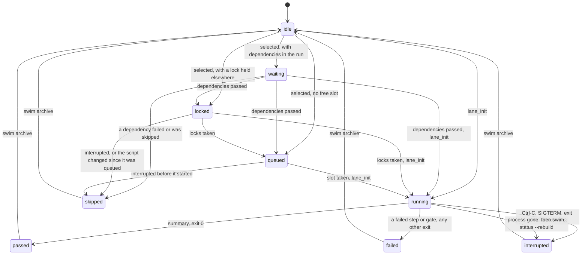
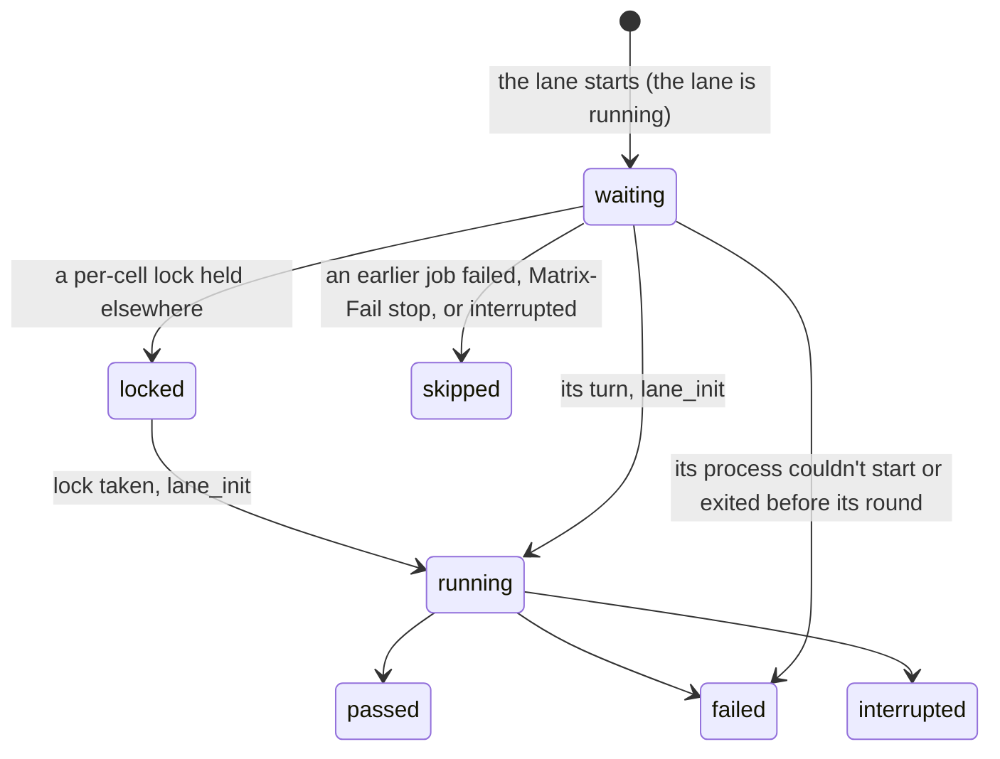
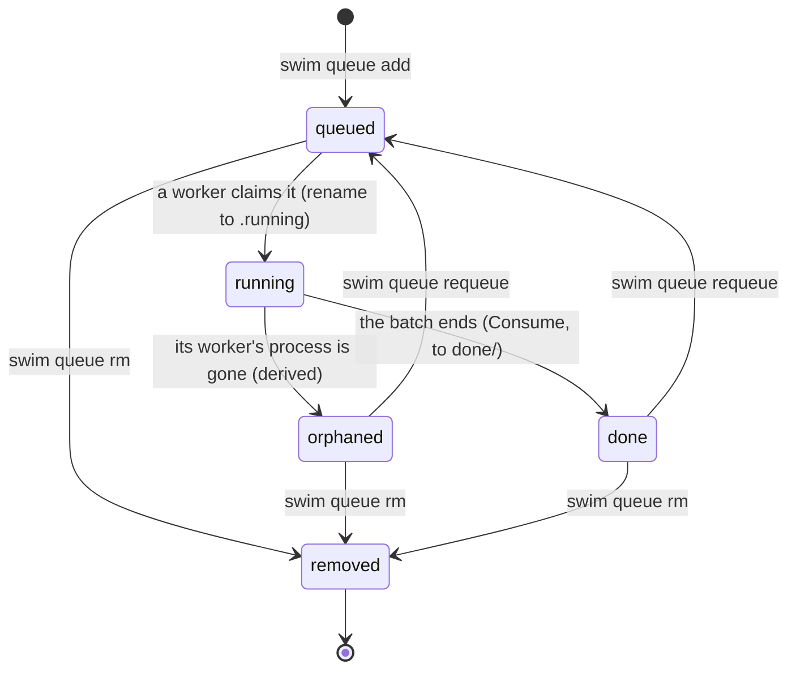
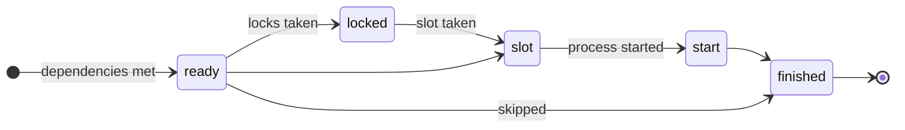
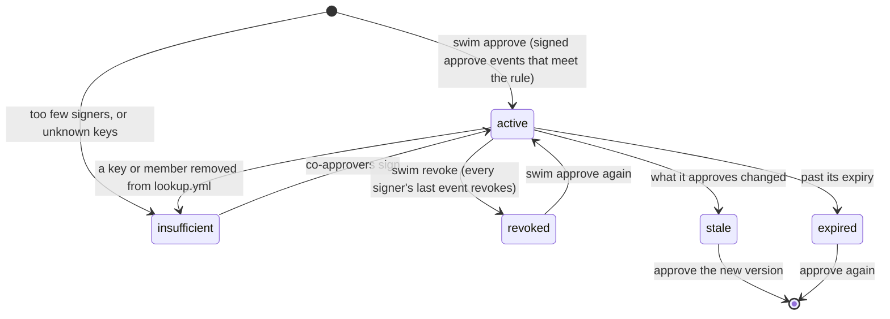

# State machines

Every state swim records, and what moves it from one to the next. The
code is the source of truth; each section names where.

[← back to the README](../README.md#reference) ·
[Architecture](architecture.md) · [Recovery](recovery.md)

Nothing checks these transitions yet: a single `Transition(from, to)`
check that every writer goes through is planned (T12 in
[tasks.md](../tasks.md)).

## Lane

A lane's state is `state:` in `.swim/status.yml` (`swim status`). The
states are in `internal/status`; the launcher (`internal/launcher`), the
lane's own hooks (`lane_init` and `summary`, through `internal/cli/hooks.go`)
and a few commands write them.

| State | Meaning | Entered when | Leaves when |
|---|---|---|---|
| `idle` | No round recorded (a new lane, or its log was archived). | `swim init`, `swim archive`, `swim status --rebuild` with no log | The lane is selected in a run, or run directly with bash. |
| `waiting` | Selected in a run; waiting for lanes it names in `After:`. | The launcher, before the lane starts | Its dependencies end. |
| `locked` | Waiting for a resource lock (`# Locks:`). | The launcher | It takes the locks, or the run is interrupted. |
| `queued` | Waiting for a free slot (`--parallel`, `max_parallel`). | The launcher | It gets a slot, or the run is interrupted. |
| `running` | Its process is running the round. | `lane_init` (in the lane's process) | `summary`, or the process exits. |
| `passed` | The round ended with exit 0. | `summary`, or the launcher if the process died before `lane_init` | The lane runs again, or is archived. |
| `failed` | A step or gate failed, the round exited non-zero, or swim refused to start it (a blocked command, no runner). | `summary`, or the launcher | As `passed`. |
| `interrupted` | Stopped by a signal, or its process vanished. | `summary` on exit 129, 130, 137 or 143; `swim status --rebuild` for a lane with no live process | As `passed`. |
| `skipped` | Never started: a dependency failed or was skipped, the run was interrupted before it started, or a queued script or env changed since it was queued. | The launcher | As `passed`. |

Notes:

- **A lane run directly** (`bash lane.N.sh`) goes from whatever it was
  straight to `running`.
- **A lane whose process died** without a trap (a closed terminal,
  SIGKILL) stays `running` in the file. `swim status` shows it as
  `running?`; `swim status --rebuild` reads the log and records it as
  `interrupted`. A new run of the lane isn't blocked: its dead pid file
  doesn't count. See [recovery](recovery.md#a-lane-stuck-running).
- **Passed lanes** are left alone by `swim all` (unless `--rerun`, or an
  Always lane with `Rerun-Children: yes` above them). `swim run N` reruns
  them.

## Job and matrix cell

A lane of jobs (`# swim job 1.2`) or a matrix round (`# Matrix:`) runs each
job or cell as its own process, with its own entry under the lane's
`cells:` in `.swim/status.yml` and the same states
(`internal/launcher/matrix.go`).

- **Jobs** run one at a time in file order; the first failure skips the
  rest (`an earlier job failed`).
- **Cells** run up to `Matrix-Parallel` at a time; `Matrix-Fail: stop`
  skips the cells not yet started after a failure.
- **The lane's own result** is `passed` when every job or cell passed,
  `interrupted` when one was interrupted (and none failed), and `failed`
  otherwise (a skipped one counts as a failure).

## Queue entry

A queued batch is one file under `.swim/queue/`, and its name is its state
(`internal/queue`). Moves are renames, which are atomic.

| State | File | Entered by | Notes |
|---|---|---|---|
| `queued` | `NNNN-q-<utc>-<hex>.queue` | `swim queue add`, `swim watch --approved`, `swim queue requeue` | Requeue gives a new sequence number, at the back of the queue. |
| `running` | `NNNN-....running`, with `worker:` (host, pid, user) | `swim watch` claims it (`ClaimNext`, or `r` on a batch in the watch screen) | Of two workers racing, exactly one rename succeeds. |
| `orphaned` | the same `.running` file | Not written: `swim queue` derives it when the worker's pid on this host is gone | A claim from another host is assumed alive (T6, pending). Never run again on its own. |
| `done` | `done/NNNN-....yml`, with `result:` | `Consume`, when the batch ends: passed, failed or interrupted alike | A half-run batch is never retried on its own. |
| removed | none | `swim queue rm` | Refused while `running`. |

`swim queue requeue` refuses a `queued` entry (already waiting) and a
`running` one (stop that worker first).

## Run record

`.swim/runs/<run id>.yml` (`swim.runrec/v1`, `internal/runrec`) is written
once, when a run ends; `swim timeline` reads it. It has no live states:
each lane gets the times it reached each point and how it ended.

A lane's final `state` is one of `passed`, `failed`, `skipped` or
`interrupted`. A point a lane never reached is left out.

## Approval

Signed approvals are files under `approvals/` (`internal/sigfile`): an
ordered, hash-linked log of approve and revoke events, one file per
approved script (or per standing approval). Each signer's last event
decides whether they stand behind it. An approval's state
(`sigfile.State`, shown by `swim approve` and `swim verify`) is one of:

- **Active:** it counts toward `lookup.yml`'s rule for the guard.
- **Insufficient (why):** its signers don't meet the rule on their own
  (signatures from several files still count together), none is in
  `lookup.yml`, or a standing approval outlasts `standing.max`. Users,
  keys and groups' members are read live, so this can change either way
  without a new event.
- **Revoked:** every signer's last event revokes. The events stay: the
  file is append-only, and a round that already ran keeps its record.
- **Expired:** past its `--expires`. A standing approval always has one:
  30 days by default, never more than `lookup.yml`'s `standing.max`.
- **Stale (why):** what it approves changed. A script approval names the
  script's SHA-256 and its execution manifest (which pins `swim.yml`'s
  policy and all of `lookup.yml`'s `require:` rules); a standing approval
  names the rule each guard had. Once one changes, stricter or looser, the
  approval stops counting there (the file stays). `swim approve` and
  `swim verify` say why; approve again.
- **Grandfathered:** a standing approval from before they expired (never
  expiring, no rules bound) stays active with a warning until `lookup.yml`
  sets `standing.max`, then becomes insufficient.
- **Evidence-bound approvals** count only while the run's evidence matches
  what was approved (not compared under `swim watch`).
- **Live-view answers** (`y` / `n` ahead of a prompt) aren't files: they
  are pinned to the script and last one run.
