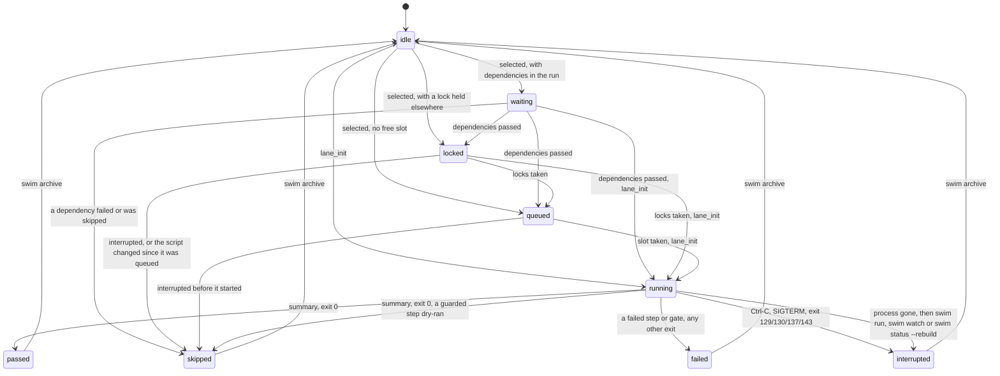
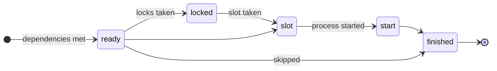
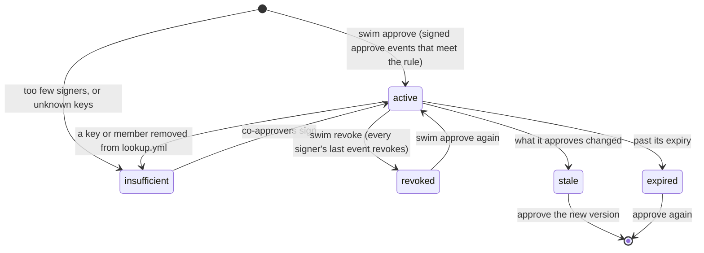

# State machines

Every state swim records, and what moves it from one to the next. The
code is the source of truth; each section names where.

[← back to the README](../README.md#reference) ·
[Architecture](architecture.md) · [Recovery](recovery.md)

Every write of `.swim/status.yml` goes through one check,
`status.Transition` (`internal/status/transition.go`), against the lane
rules below. An illegal move panics in tests and wherever
`SWIM_CHECK_STATES=1` is set (both e2e suites set it); elsewhere the write
goes through, since the file is the last known state and refusing would
leave a lane stuck. `swim status --rebuild`, which reconstructs every entry
from the logs, is the one writer that isn't checked. Queue entries and run
records are checked too, under the same switch: every move of a queue
entry's file goes through `queue.Transition`
(`internal/queue/transition.go`; an illegal move is refused even where it
doesn't panic), and every run record write through `runrec.Transition`.

## Lane

A lane's state is `state:` in `.swim/status.yml` (`swim status`). The
states are in `internal/status`; the launcher (`internal/launcher`), the
lane's own hooks (`lane_init` and `summary`, through `internal/cli/hooks.go`)
and a few commands write them.

What the check enforces (`Transition`) for a lane:

- **A running round only ends:** `running` goes to `passed`, `failed`,
  `skipped` (it dry-ran a guarded step) or `interrupted` (or to `running`
  again, a new `lane_init`), never back to waiting or `idle`.
- **A lane waiting for its turn** (`waiting`, `locked`, `queued`) moves on
  or ends, but never goes back to `idle`.
- **A finished result never changes in place:** `passed`, `failed`,
  `skipped` and `interrupted` turn into one another only as a new round
  (another start time or run id). A failure never becomes a pass.
- At rest (`idle` or finished), anything may follow: a new round, an
  archive, a refusal, a skip.

| State | Meaning | Entered when | Leaves when |
|---|---|---|---|
| `idle` | No round recorded (a new lane, or its log was archived). | `swim init`, `swim archive`, `swim status --rebuild` with no log | The lane is selected in a run, or run directly with bash. |
| `waiting` | Selected in a run; waiting for lanes it names in `After:`. | The launcher, before the lane starts | Its dependencies end. |
| `locked` | Waiting for a resource lock (`# Locks:`). | The launcher | It takes the locks, or the run is interrupted. |
| `queued` | Waiting for a free slot (`--parallel`, `max_parallel`). | The launcher | It gets a slot, or the run is interrupted. |
| `running` | Its process is running the round. | `lane_init` (in the lane's process) | `summary`, or the process exits. |
| `passed` | The round ended with exit 0, and every guarded step it reached was approved. | `summary`, or the launcher if the process died before `lane_init` | The lane runs again, or is archived. |
| `failed` | A step or gate failed, the round exited non-zero, or swim refused to start it (a blocked command, no runner). | `summary`, or the launcher | As `passed`. |
| `interrupted` | Stopped by a signal, or its process vanished. | `summary` on exit 129, 130, 137 or 143; for a lane with no live process, the next `swim run` (`all`, `ci`) or `swim watch` (`ReapDead`, exit 137), or `swim status --rebuild` | As `passed`. |
| `skipped` | Didn't do its work: it never started (a dependency failed or was skipped, the run was interrupted before it started, or a queued script or env changed since it was queued), or it ran to the end but dry-ran a guarded step (`reason: dry run: <step>`). | The launcher, or `summary` for a dry run | As `passed`. |

Notes:

- **A lane run directly** (`bash lane.N.sh`) goes from whatever it was
  straight to `running`.
- **A lane is claimed** by `lane_init` under a lock on
  `.swim/laneN.claim`, which records the process's pid, start time and
  host; `.swim/laneN.pid` holds the bare pid. Of two processes starting one lane
  at once, exactly one gets it. A lane counts as running only while that
  pid is alive with that start time, so a pid the kernel has since given
  to another process doesn't hold the lane (a pid file from an older swim,
  with no matching claim, falls back to the pid alone).
- **A lane claimed on another host** (two machines sharing the repo, such
  as a laptop and a container mounting it) counts as held: this machine
  can't see that process, so it never takes it for dead. It doesn't reap
  it, start it again, or remove its pid file (`swim doctor --fix`); that
  host's swim does. `status.yml` names the host too (`host:`), and `swim
  status` shows `running ... on <host>`. If that machine is gone for good,
  remove `.swim/laneN.pid` and run `swim status --rebuild`.
- **A lane whose process died** without a trap (a closed terminal,
  SIGKILL, a crash, a reboot) stays `running` in the file, and `swim
  status` shows it as `running?`, until the next `swim run`, `swim all`,
  `swim ci` or `swim watch` starts: each first ends such rounds as the
  launcher ends a killed lane's (`launcher.ReapDead`): the cut-off step
  is recovered as failed, the log gets `END INTERRUPTED` (exit 137), the
  chain a round entry, and the lane is `interrupted`. `swim status
  --rebuild` does the same for status alone. A new run of the lane isn't
  blocked either way. See [recovery](recovery.md#a-lane-stuck-running).
- **A paused lane** (`swim pause`) stays `running` (or `waiting`, paused
  before it starts): its process holds before its next step, so every
  check that a lane is running still holds. `paused_at`, `paused_by`,
  `paused_after`, `next_step` and `pause_note` say so while it holds;
  `paused_s` is the round's total paused time, which its `Timeout:`
  deadline moves out by. The request is `.swim/laneN.pause` (the run,
  who, when, the note), ignored and cleared for another run as a stop
  request is; `.swim/pause` is the repo-wide pause (`--all`), which also
  keeps swimmers from claiming batches. The log's `PAUSE` and
  `RESUME` lines count toward nothing; a swim from before them skips them.
- **A claimed lane** (`swim new`, `swim claim`) has a lease in
  `.swim/claims/lane.N.yml` (owner, session, host, created, expires, job)
  while a session writes its round. It isn't a lane state: it guards
  `swim new`, `stub` and `archive` from other sessions, and ends when the
  lane starts running, is archived or stubbed, is released, or expires (an
  expired one is removed by the next command that reads it). Changes are
  serialised by `flock` on `.swim/claims/.lock`.
- **Passed lanes** are left alone by `swim all` (unless `--rerun`). `swim
  run N` reruns them.

## Queue entry

A queued batch is one file under `.swim/queue/`, and its name is its state
(`internal/queue`). Moves are renames, which are atomic.

| State | File | Entered by | Notes |
|---|---|---|---|
| `queued` | `NNNN-q-<utc>-<hex>.queue` | `swim queue add`, `swim watch --approved`, `swim queue requeue` | Requeue gives a new sequence number, at the back of the queue. |
| `running` | `NNNN-....running`, with `worker:` (host, pid and start time, user, heartbeat, lease) | `swim watch` claims it (`ClaimNext`, or `r` on a batch in the watch screen) | Of two workers racing, exactly one rename succeeds. The worker renews `heartbeat` every third of its `lease` (`queue_lease`, default 2m) while the batch runs. |
| `orphaned` | the same `.running` file | Not written: `swim queue` derives it. On the swimmer's host: its pid is gone, or now another process (start time). From another host: its heartbeat is older than its lease | A claim by an older worker (no heartbeat) can't be judged from another host and stays `running`. Never run again on its own. |
| `done` | `done/NNNN-....yml`, with `result:` | `Consume`, when the batch ends: passed, failed or interrupted alike | A half-run batch is never retried on its own. |
| removed | none | `swim queue rm` | Refused while `running`. |

`swim queue requeue` refuses a `queued` entry (already waiting) and a
`running` one (stop that swimmer first). `queue.Transition` holds every move
to the diagram: consuming an entry no swimmer claimed, consuming one twice,
or claiming a consumed one is a bug, and panics under `SWIM_CHECK_STATES`.

## Run record

`.swim/runs/<run id>.yml` (`swim.runrec/v1`, `internal/runrec`) is written
once, when a run ends; `swim timeline` reads it. It has no live states:
each lane gets the times it reached each point and how it ended.

A lane's final `state` is one of `passed`, `failed`, `skipped` or
`interrupted`. A point a lane never reached is left out. `runrec.Transition`
checks every write: each lane has ended, and a rewrite of the same run (the
same start) never changes a lane's result.

## Approval

Signed approvals are files under `approvals/` (`internal/sigfile`): an
ordered, hash-linked log of approve and revoke events, one file per
approved script (or per standing approval). Each signer's last event
decides whether they stand behind it. An approval's state
(`sigfile.State`, shown by `swim approve` and `swim verify`) is one of:

- **Active:** it counts toward `lookup.yml`'s rule for the guard.
- **Insufficient (why):** its signers don't meet the rule on their own
  (signatures from several files still count together), none is in
  `lookup.yml`, or a standing approval outlasts `standing.max`. Users,
  keys and groups' members are read live, so this can change either way
  without a new event.
- **Revoked:** every signer's last event revokes. The events stay: the
  file is append-only, and a round that already ran keeps its record.
- **Expired:** past its `--expires`. A standing approval always has one:
  30 days by default, never more than `lookup.yml`'s `standing.max`.
- **Stale (why):** what it approves changed. A script approval names the
  script's SHA-256 and its execution manifest (which pins `swim.yml`'s
  policy and all of `lookup.yml`'s `require:` rules); a standing approval
  names the rule each guard had. Once one changes, stricter or looser, the
  approval stops counting there (the file stays). `swim approve` and
  `swim verify` say why; approve again.
- **Grandfathered:** a standing approval from before they expired (never
  expiring, no rules bound) stays active with a warning until `lookup.yml`
  sets `standing.max`, then becomes insufficient.
- **Evidence-bound approvals** count only while the run's evidence matches
  what was approved (not compared under `swim watch`).
- **Live-view answers** (`y` / `n` ahead of a prompt) aren't files: they
  are pinned to the script and last one run.
