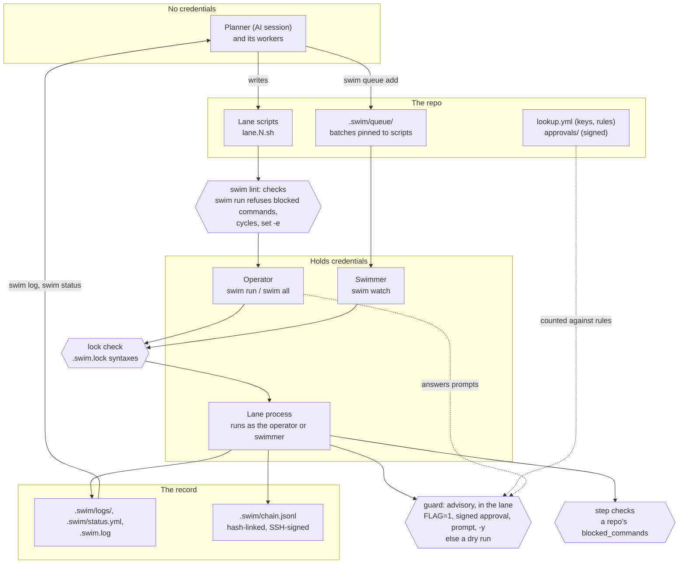

# Using swim

How swim works, the ways people run it day to day, and the reference for
every feature, command, file and setting. New to swim? Start with
[the README](../README.md) and its five-minute quickstart, or
[swim in an hour](quickstart.md). AI agents: start with `swim guide`.

[← back to the README](../README.md) · [The docs](README.md) ·
[Trust model](trust-model.md)

## How it works

An AI session (the *planner*) and its subagents (the *workers*) write
operational work as small scripts (bash, Python, TypeScript, or any
program), one per *lane*: numbered, and named if you like (`swim new
renew-certs "Renew the certs"`, then `swim run renew-certs`). A person
runs them with `swim`, in places the AI can't reach: a VPN-only account,
their own credentials, production. Every step, result and approval lands in
plain-text logs the AI reads back to decide what to do next.

> The session writes. The operator runs. The log reports.

```
swim · myrepo · main@64a0e07 · 0:04
 swim 1  PASS 0:01                  Diamond root: fetch pages              51c7cf2e
 swim 2  PASS 0:03                  Child A: convert to Markdown           d7af1473
 swim 3  / running 0:04             Child B: link stats                    0acffc31
 swim 4  / waiting on swim 3        Join: build report                     db8e71f9
──────────────────────────────────────────────────────────────────────────────────
[3] ==> compute stats.json
[3] $ e2etool stats
[3] PASS  compute stats.json  0.1s
```

swim is a flywheel for AI-assisted operations work: every round leaves a
log, a status and an archive behind, so the next round, session or person
picks up where the last one stopped instead of starting over.

What you get:

- **The AI writes, but never needs your access:** no production
  credentials, VPN or authority. Only your machine, or a swimmer you
  control, runs anything.
- **Work survives the session:** scripts, status, queue and logs live in
  the repo, so a new session or another agent catches up with `swim log`
  instead of having everything explained again.
- **Nobody waits on anybody:** the AI queues the next batch while you're
  busy; you approve in batches or ahead of time, and a swimmer runs it.
- **Parallel lanes with dependencies:** independent rounds run at once, and
  dependent ones wait for the rounds they depend on.
- **Changes are dry runs until a person approves them:** destructive steps
  sit behind guards. You approve at the terminal, with a flag, or with a
  signed approval from a teammate somewhere else.
- **Logs both people and agents can read:** one plain-text format, readable
  with `cat` and parseable by an agent. Results go back to the AI as compact
  text, not output pasted into chat, so they cost little context.
- **A tamper-evident record:** every approval and every round is signed and
  hash-linked, so you can prove what ran and who approved it.
- **The same rounds from a terminal, a queue or CI.**

## How it fits together



Credentials live only with the operator and the swimmer; the guard runs
inside the lane, so it is advisory. More in
[the architecture](architecture.md).

## Common usage patterns

Each pattern builds on the ones before it. Start with the first; reach for
the others when you need them.

### 1. Run a round yourself

```sh
cd your-repo
swim init                                  # config entry, .gitignore block, .swim/status.yml
swim new 1 "Cut over orders-api"           # writes lane.1.sh from a template
$EDITOR lane.1.sh                          # fill in the steps (or have an AI write them)
swim lint                                  # check the scripts before you run them
swim status                                # each pending round: what it waits on, its guards
swim all                                   # run every pending lane, with a live view
swim log 1                                 # what happened, step by step
swim archive 1 && swim stub 1 "orders done"   # keep the log, free the lane for the next round
```

### 2. Let an AI plan, workers write, and you run

The planner splits the work into lanes and gives each worker one lane. Each
worker writes only its own `lane.N.sh`. You run `swim all` and the agents
read the results back:

```sh
swim report --earmark       # everything new since you last looked, in full, then mark your place
swim status                 # what every lane is doing (or: cat .swim/status.yml)
swim log 2                  # a lane's log; swim log <job-id> works too
swim log                    # .swim.log: one line per top-level action, for catching up
```

The conventions agents follow live in `swim guide`: which lanes to use,
never editing a running lane, gates before changes, and how to read results.

### 3. Run a DAG in parallel

A round declares what it waits for, and swim schedules it:

```bash
# After: 2 3        # in lane.4.sh: start once swim 2 and swim 3 have passed
```

```sh
swim status         # each pending lane: what it waits on, and where that stands
swim all --parallel 8
```

### 4. Make a guarded change

Destructive steps sit behind a `guard`. With the flag unset, swim asks the
person at the terminal; with no one to ask, the step is a dry run:

```bash
if guard ORDERS_ALLOW_SST_REMOVE "remove SST stack orders-prod (tf owns it now)"; then
  run "sst remove" npx sst remove --stage prod
fi
```

```sh
swim status 2                             # how swim run would decide each guard now
swim run 2                                # asks: swim 2 requires human approval of guard ORDERS_ALLOW_SST_REMOVE ... Y/N [N]
ORDERS_ALLOW_SST_REMOVE=1 swim run 2      # approved up front (scripts, CI)
swim all -y                               # approve every question this run, logged as -y
```

A round whose guarded step dry-ran ends SKIP, not PASS, and the lanes
after it wait for a round that did the work.

### 5. Queue work and let a swimmer fire it

Get a batch ready while other work runs, then let it start as soon as swim
is idle:

```sh
swim queue 4 5 --approve ORDERS_ALLOW_SST_REMOVE --note "cutover batch"
swim watch                                # the swimmer: runs queued batches when idle
swim queue 6 --wait --timeout 30m         # queue, then block until it finishes (exit = its result)
swim wait                                 # block until nothing runs and nothing is queued
swim log 3f2a9c1e --until-done            # wait for one job; exits with its round's status
```

### 6. Approve from anywhere, as a team

Approvers sign the exact script, from their own machine, with their SSH key:

```sh
swim approve 4 --guards FIN_ALLOW_DROP    # approve lane 4's exact script; co-approvers run the same
swim approve --auto bob                   # standing approval: every job bob queues, for 30 days or until revoked
swim revoke --auto bob
swim watch --approved                     # run scripts as soon as they're fully approved
swim verify                               # prove the record hasn't been tampered with
swim history --oneline                    # who approved and ran what, like git log
```

`lookup.yml` says whose key is whose and how many approvals a guard needs
(see [Approvals](#approvals)).

### 7. Run rounds in CI

```sh
swim ci --changed --junit swim.xml        # only the rounds this push changed
```

Each lane's log gets its own foldable section, and failures become
annotations. See [CI](#ci).

### 8. Drive swim from scripts and agents

Every read command has a versioned YAML form, and long waits have proper
exit codes:

```sh
swim run 1 2 --yaml           # a stream of events: start, step, finish, summary
swim status --yaml
swim log 2 --yaml             # the round parsed: steps, commands, output, results
```

## Features

### Lanes, rounds and jobs

| Term | Meaning |
|---|---|
| **lane** | A numbered slot, `swim 1..99`, with one script (`lane.N.sh`, or `lane.N.py`, `lane.N.ts`, a binary `lane.N`, ...) and one log. One worker owns it at a time. |
| **round** | What a lane script holds: one goal ("cut over service X"). Disposable. |
| **job** | A round's unique id (its `# Job:` line). It's recorded everywhere, exported to steps as `$SWIM_JOB`, and usable wherever a lane number is: `swim run 3f2a9c1e`. Naming a job pins the run to that exact round, so a lane rewritten in the meantime is refused. |
| **step** | One command run through `run`, `gate` or `snapshot`, logged with its command, output and exit code. |
| **gate** | A step whose failure stops the round before any later (destructive) step. |
| **guard** | A named approval in front of a destructive step (below). |

### Lane scripts

`swim new` writes a template. A filled-in round:

```bash
#!/usr/bin/env bash
# swim: syntax 4
# Round:   Cut over orders-api from SST to Terraform
# Job:     3f2a9c1e-7b4d-4e2a-9c1e-7b4d4e2a9c1e
# After:   1
# Owner:   zach
# Guards:  ORDERS_ALLOW_SST_REMOVE  remove SST stack (tf owns it)
# Locks:   tf/orders
# Timeout: 30m
_swim_lib=$("${SWIM_BIN:-swim}" lib) || exit 1; eval "$_swim_lib"
lane_init 2

stage snapshot
snapshot "cfn template" aws cloudformation get-template --stack-name orders-prod
stage check
run  "tf plan" terraform -chdir=infra/orders plan -detailed-exitcode
gate "DeletionPolicy is Retain" bash -c 'aws cloudformation get-template --stack-name orders-prod | grep -q Retain'
stage change
if guard ORDERS_ALLOW_SST_REMOVE "remove SST stack orders-prod (tf owns it)"; then
  run "sst remove" npx sst remove --stage prod
fi
stage verify
run "re-plan is a no-op" terraform -chdir=infra/orders plan -detailed-exitcode
summary
```

- **Header:** only `Round` is required. Missing keys get defaults: a `Job`
  is generated when the round starts, and guards are found from `guard`
  calls in the body. Unknown keys are kept and shown in the log.
- **Stages:** every round uses the same four, in order: `snapshot`
  (read-only capture), `check` (checks and gates), `change` (guarded
  changes) and `verify` (prove it worked). Skip the ones you don't need.
  Running them out of order logs a `WARN`.
- **Time limits and retries:** `run`, `gate` and `snapshot` take
  `--timeout 2m`, `--retry 3`, `--backoff 5s` and `--retry-on 1,255` before
  the label. `# Step-Timeout: 5m` sets a default for every step, and the
  round's `Timeout` always wins. Only retry idempotent steps.
  - A limit stops everything the step started: each step runs in its own
    process group, which gets SIGTERM, then SIGKILL after 5s.
  - Except a step whose stdin is the terminal (a lone lane run from a
    terminal): it stays in the lane's group so it can read the keyboard, and
    a limit stops only its own process.
- **Library:** the functions are `lane_init`, `stage`, `run`, `gate`,
  `snapshot`, `guard`, `decide`, `confirm`, `last_failed`, `any_failed`,
  `drift`, `stop` and `summary`. It runs on macOS's bash 3.2.
- **Failures:** a failed `run` doesn't stop the round; a failed `gate` does.
  Don't use `set -e`.
- **Pre-approve in the live view:** select a lane that hasn't asked yet
  and press `y` (or `n`) to answer its guards ahead of time, then walk away.
  The answer is pinned to the script and lasts this run only.
- **Outputs between lanes:** `# Outputs: stats.json` promises files in
  `$SWIM_OUT`, and a dependent lane reads them with
  `"$(input 2 stats.json)"` (or `output KEY value` / `$(input 2 KEY)` for
  small values). Outputs are hashed into the chain on both sides, so
  `swim verify` proves the report was built from exactly those stats.
- **Status messages:** `msg --progress 7/25 "migrating billing"` (or
  `swim msg` from any language, even inside a step) shows where a long job
  is now, in the live view and `swim status`. The latest wins, and
  the log keeps throttled `MSG` lines.
- **Fail hard** (syntax 3 or later): `# Fail: hard` ends the round at the
  first failed step (`run --soft` opts one out). A rollback is its own
  lane, run when you decide to, or a guarded step of this one.
- **Checks:** `swim lint` checks scripts before you run them: header,
  stages, guards, bash 3.2, blocked commands, and secrets echoed to the log.

### Lanes in other languages

A lane script can be any runnable: `lane.N.py`, `lane.N.js`, `lane.N.ts`, a
compiled `lane.N`, a plain bash script. It calls swim's steps as commands
(below); there is no SDK. Local modules it imports are pinned with it when
`# Includes:` lists them.

How swim runs it:

1. `lane.N.sh` runs with bash, as always.
2. A `#!` line wins, and swim asks nothing.
3. Otherwise, `runners:` for the extension: your own (saved per repo in
   your config) wins over the repo's committed `swim.yml`.
4. A compiled or executable file runs as itself.
5. The first time swim meets an extension with none of these, it looks up
   the usual runners on `PATH` and asks:

   ```
   swim: lane.2.ts is the first .ts lane here: it has no #! line, and no runner is set for .ts files.
     1) /usr/local/bin/tsx
     2) /opt/homebrew/bin/bun
   Run .ts lanes with /usr/local/bin/tsx? [Y/n, a number, or type a command]:
   ```

   It saves the answer as `runners.ts` for this repo. In CI, or under
   `swim watch`, nobody is there to ask, so the lane fails at start with the
   exact fix: a `#!` line, `swim config runners.ts tsx`, or
   `runners: {ts: tsx}` in `swim.yml`.

swim runs the program inside a wrapper. The wrapper opens and closes the
round and exports `SWIM_LANE`, `SWIM_JOB` and the rest. Steps are swim commands, so any language can call them:

```python
#!/usr/bin/env python3
# Round:  Rotate the orders bucket
# Guards: ORDERS_ALLOW_DELETE  delete the old bucket (2026-10-13: replaced)
import os, subprocess
def swim(*a): return subprocess.run([os.environ.get("SWIM_BIN", "swim"), *a]).returncode

swim("stage", "check")
swim("gate", "new bucket exists", "--", "aws", "s3api", "head-bucket", "--bucket", "orders-v2")
swim("stage", "change")
if swim("guard", "ORDERS_ALLOW_DELETE", "delete bucket orders (2026-10-13: replaced)") == 0:
    swim("run", "delete old bucket", "--", "aws", "s3", "rb", "s3://orders")
```

- **The commands:** `swim run|gate|snapshot "<label>" -- cmd`,
  `swim guard FLAG "<action>"` (exit 0 when approved), `swim stage NAME`,
  `swim drift "<what>"` and `swim stop "<why>"`.
- **Ending the round:** a failed gate, `swim stop`, a blocked command or
  your Ctrl-C ends the program, even if it ignores the exit code; no later
  step runs.
- **No swim calls:** a program that never calls `swim run` is logged as one
  step, with its whole output (secrets masked) and a result from its exit
  code.
- **Header:** `#` or `//` comments. A binary, or any lane, can keep its
  header in a sidecar `lane.N.yml` instead, and the sidecar's keys win:
  `round`, `job`, `after`, `guards` (a map of flag to action), `locks`,
  `timeout`, `step-timeout`.

### Logs

Logs are plain text, readable with `cat`. Each line's start says what it
is, and command output is always fenced with `| `, so
`grep '^  FAIL' .swim/logs/agent2.log` finds every failure:

```
== ROUND 2026-10-09T12:00:00Z  job=3f2a9c1e-...  Cut over orders-api
   script: lane.2.sh | owner: zach | after: 1 | timeout: 30m | git: main@abc1234 | sha256: e91a058b9c06

-- stage check  12:00:02
  FAIL  tf plan (exit 2)                        3.1s  12:00:02
        $ terraform -chdir=infra/orders plan -detailed-exitcode
        | Error: ...
  STOP  gate failed: tf plan

== END FAIL  pass=1 fail=1 skip=0 drift=0  exit=1  3.6s  2026-10-09T12:00:04Z
   stages: snapshot PASS | check FAIL | change none | verify none
```

- **`swim log N`** renders a log on a terminal: colours, times relative to
  the round's start, and long output folded (`--full` expands it). Piped,
  or with `--raw`, it prints the file as is.
- **The step running now** isn't in the file until it ends. `swim log` adds
  it, with its output so far, as `RUNNING  <label> (in progress)`.
- **`swim log N -f`** follows a lane live, like `tail -f`.
- **`swim log N --until-done`** waits for the round to end, then exits with
  its status.
- **`.swim.log`** is the project log: one line per top-level action. A new
  agent reads it first, and `swim note "<text>"` adds decisions to it.

### The live view

While lanes run, a panel pinned to the top of the terminal shows each
lane's state and round; output scrolls underneath, prefixed `[N]`.

- **Keys** (more than one lane on a terminal):
  - `→`/`←` open one lane's log, and `Esc` goes back to all lanes.
  - `↑`/`↓`, `PgUp`/`PgDn` and `Home`/`End` scroll.
  - Type a number and press `Enter` to jump to that lane. `f` filters to
    running or failed lanes, and `?` shows help.
- **Approvals:** a banner names a lane that's waiting for you. `Enter`
  opens it with the question underneath, and `y` or `n` answers it there.
- **No terminal, or `--plain`:** output is plain prefixed lines.
- **`--yaml`:** output is a stream of YAML events instead (see
  [Scripting](#scripting-and-yaml)).

### Dependencies, parallelism and locks

- **`# After: 2 3`** waits for those lanes to pass in this run, and skips
  the round if one fails. A job id waits for that exact round. Ordering that
  holds for every round can go in config `deps`. A cycle stops the run
  before anything starts.
- **`--parallel N`** (or config `max_parallel`) caps how many lanes run at
  once. Lanes ready to start queue for a slot, longest chain first.
- **`# Locks: orders-table`:** lanes that share a lock never run at the same
  time, in either order. That holds within a run and across concurrent runs
  on the machine. A failure doesn't spread through a lock.

`swim status` shows, under each lane holding a pending round, what its
header declares and where that stands: each lane it waits on (passed,
pending, running, failed), each guard and how `swim run` would decide it
right now (from the same flags, signed approvals and `lookup.yml` the run
reads), and its timeout, locks, includes, `Fail: hard` and target:

```
 swim 1  pending                drop the old table
          guard DROP_OK  drop table old_orders
                 not approved: approval needs 2 signature(s) from dba, has 1; swim run will ask (a dry run if no one answers)
          timeout 30m · locks orders-db · includes lib/tables.sh
 swim 2  pending                verify after the drop
          after swim 1 (pending: a dry run or failure there skips this)
```

`swim status --yaml` carries the same as `pending_header` and `deps`.

### Env files

Lanes get non-secret context (`STAGE`, `AWS_PROFILE`, table names) from
`KEY=VALUE` files. swim parses them and never runs them as shell:

```ini
# ~/.config/swim/env.swim: general keys, then a section per repo
STAGE=dev
[repo ~/dev/orders]
AWS_PROFILE=orders-prod

# <repo>/.env.swim (git-ignored): a section per lane
[lane 2]
TABLE=orders-v2
```

- **Precedence:** the shell wins, then the lane's section, the repo's
  section, `env:` in the committed `swim.yml`, and the general keys.
- **No approvals from files:** a key that is a lane's guard flag (or matches
  a `lookup.yml` guard glob) stops the run before anything starts.
- **Masked and recorded:** file values are masked in logs. The round header
  lists the files that applied, and status and the chain record a hash of
  the env. A queued lane whose env changed since it was queued is skipped.
- **`swim env N`** shows what a lane gets and where each key comes from.

### Caches

A lane can keep a tool's download cache between rounds. It names the
preset and the lockfile the tool checks the cache against:

```bash
# Cache: terraform @infra/orders/.terraform.lock.hcl
# Cache: npm @web/package-lock.json
```

swim points the tool's own cache (`TF_PLUGIN_CACHE_DIR`, `npm_config_cache`,
`PIP_CACHE_DIR`, `GOMODCACHE`) at a per-repo directory under
`~/.cache/swim`, so `terraform init`, `npm ci`, `pip install` and `go mod
download` skip what they already have.

- **The cache never decides what runs.** Only download caches a tool checks
  are presets: Terraform against provider checksums, npm against integrity
  hashes, pip against `--hash` entries, Go against `go.sum`. The lockfile is
  required and pinned in the execution manifest, so changing it stales
  approvals. Installed trees (`node_modules`, `.terraform/`) aren't cached.
- **Yours alone:** every cache directory must be yours and mode `0700`; a
  `cache_dir` under `/tmp` gets your user id appended. Clones and worktrees
  of one repo share its cache, and other repos don't.
- **Safe in parallel:** two lanes' `terraform init` take turns (Terraform's
  plugin cache isn't safe for concurrent inits); everything else shares.
- **Bounded:** a run trims the repo's caches to `cache_max` (10GB), least
  recently used first. `swim cache ls`, `swim cache rm PRESET` and `swim cache
  prune --older 30d` manage them; `swim cache path --ci` gives a CI cache
  step its directory and keys.

An installed tree (`node_modules`, a virtualenv) nothing checks on use is a
**snapshot**: the lane saves it whole and restores it in a later round,
keyed by the files it was installed from.

```bash
# Cache: snap:web/node_modules @web/package-lock.json
cache restore web/node_modules || { run "npm ci" npm ci --prefix web && cache save web/node_modules; }
```

The key hashes the tree, its `@` files (pinned like lockfiles), the OS, the
architecture and any `--with` strings. A miss passes and returns 1; a key is
written once; a save from a round with
failed steps is marked, and its restores say so. A restored tree runs
unchecked, so every restore is recorded in the round's chain entry.

### Guards and approvals

<a id="approvals"></a>

A `guard FLAG "<action>"` approves its step in one of these ways, in this
order:

1. **The flag is set.** `FLAG=1` approves up front, for CI and scripts.
   `FLAG=0` declines without asking. Under `swim run` the flag must come
   from the environment `swim run` started with (your shell, or a script
   that runs `swim run`): a lane that sets `FLAG=1` for itself gets a dry
   run, `FLAG=1 was set inside the lane, not in the environment swim run
   started with`.
2. **A signed approval.** Approvals of this exact execution manifest (see
   [below](#execution-manifest)), plus standing approvals for whoever queued
   the batch, are counted against `lookup.yml`'s rule for the guard.
3. **The person at the terminal** answers
   `swim 2 requires human approval of guard FLAG ... the lane says: <action>  Y/N [N]`.
   swim names the lane, job and manifest itself; the action is the lane's
   own words, labelled as such. A flag the script doesn't declare is
   refused. Questions from parallel lanes take turns, or wait on their lane
   in the interactive view.
4. **`-y`:** `swim all -y` (or `swim watch -y`) approves every question,
   and logs that `-y` did. `swim status` lists the guards under the lane
   (`approved without a prompt: DEPLOY (swim run -y)`), as do the round's
   chain entry and `swim ci`'s summary.

Anything else is a **dry run**: the step is skipped, and the log says how to
approve it. A queued batch never asks a question. A round that dry-ran a
guarded step ends **SKIP**, not PASS (`dry run: <step>`): it didn't do
its work, so a lane that waits on it (`# After:`) doesn't start, the run
exits 3 (nothing failed, but work waits on an approval; `swim ci`
counts it as a pass, since CI can't approve), and `swim all` runs it
again next time.

Under `swim run` the launcher, not the lane, decides all of this: it reads
`approvals/` and `lookup.yml` once, as the run starts (an approval signed
mid-run counts from the next run), and it writes each approval to the chain
itself. A lane can't record an approval of its own, and once the run ends
`swim verify` checks every approval against what the run recorded.

Signed approvals are files under `approvals/`. Commit them, so approvers can
add theirs from anywhere. Each file is an ordered, hash-linked log of SSH-signed
approve and revoke events, so its order is part of what it proves, like git
commits:

```sh
swim approve 4 --guards FIN_ALLOW_DROP     # this exact manifest (it lists what it pins); co-approvers run the same
swim approve --auto bob [--guards A,B]     # every job bob queues, until it expires (30d) or is revoked
swim revoke 4 / swim revoke --auto bob     # withdraw yours
swim approve                               # list approvals and who stands behind each
```

`lookup.yml` (committed at the repo root) says whose key is whose, groups
people, and sets what each guard needs:

```yaml
users:
  zach:  {keys: ["ssh-ed25519 AAAA... zach@laptop", "sk-ssh-ed25519@openssh.com AAAA... zach@yubikey"]}
  alice: {keys: ["ssh-ed25519 AAAA... alice@work"]}
  bob:   {keys: ["ssh-ed25519 AAAA... bob@ci"]}
groups:
  platform-admin: [zach, alice]
require:
  - guards: [FIN_ALLOW_*]
    group: platform-admin
    count: 2              # two different people from platform-admin
standing:
  max: 90d                # the longest a standing approval may last
```

Script approvals and standing approvals count together: zach's standing
approval of bob's jobs plus alice's approval of the script make two
platform-admins. If a script, or anything else its manifest pins, changes
after it was approved, the approval no longer matches it, and swim says why
(`stale: includes lib/orders.sh changed`). `swim keys` shows who's who.

Approvals have a lifecycle, and `swim approve` shows each one's state:
**active**, **expired**, **revoked**, **stale** (what it approves changed)
or **insufficient** (its signers don't meet the rule). A standing approval
lasts 30 days unless `--expires` says otherwise, never longer than
`standing: {max: 90d}` in `lookup.yml`, and binds the rule each guard had
when it was signed: change that rule, stricter or looser, and it stops
counting for that guard (a script approval binds every rule through its
manifest). Who is who is read live, so a key removed from `lookup.yml`
stops counting at once. A standing approval from before they expired keeps
counting, with a warning, until `lookup.yml` sets `standing.max`.

### Decisions

A guard asks "may I?". A decision asks "which way?": the lane puts two to
nine numbered choices to the operator and branches on the number.

```bash
# Decisions: ROLLOUT  how api 2.4.1 goes out

stage change
decide ROLLOUT "How should api 2.4.1 roll out?" \
  "canary: 10% for 15 minutes, then the rest" \
  "all at once" \
  "don't deploy; stop here"
case $DECISION in
  1) run "canary 10%" deploy api 2.4.1 --percent 10 ;;
  2) run "deploy all" deploy api 2.4.1 --percent 100 ;;
  3) stop "the operator chose not to deploy" ;;
esac
```

swim asks, not the script, and accepts only a listed number:

```
swim 1 asks for a decision: ROLLOUT
  job 3f2a9c1e · manifest 91c014326e1a
  the lane asks: How should api 2.4.1 roll out?
    1. canary: 10% for 15 minutes, then the rest
    2. all at once
    3. don't deploy; stop here
  choose 1-3 (or set ROLLOUT=N to answer without asking):
```

- **Answering:** `ROLLOUT=2 swim run 1` answers ahead (only swim run's own
  environment counts, as for a guard flag); `swim queue add 1 --decide
  ROLLOUT=2` answers for a queued batch; otherwise the operator picks a
  number at the prompt, or with a number key on the lane in the live view.
  `-y` answers no decision, and there is no default.
- **Unanswered:** with nobody to ask (`--no-prompt`, CI, a batch without
  `--decide`), a value that isn't one of the numbers, or a `ROLLOUT=N` the
  lane set itself, the log says `SKIP ... decision needed` and the round
  ends there, SKIP, as a dry run: no branch runs, `swim run` exits 3, and a
  lane `# After:` it doesn't start.
- **Declared:** `# Decisions: NAME  <what it decides>` lists each decision
  a round may ask; one it doesn't list is refused. `swim lint` errors on an
  undeclared decision (`--fix` adds the line), on fewer than two or more
  than nine choices, and on `decide` in `$(...)` or a pipe, where it can't
  set `DECISION` or end the round (call it on its own line).
- **On the record:** `DECIDED  ROLLOUT: 2. all at once (ROLLOUT=2)` in the
  log, `decided ...` in `swim status`, and a `decide` entry in the chain
  (question, choices, the number, who and how), which swim run's
  attestation lists and `swim verify` checks. `swim history` shows
  `decide ROLLOUT=2 for swim 1 by zach via flag`.
- **Not an approval:** a decision steers; it never approves a guarded
  step. Put the destructive step on a branch behind `guard` as usual.
- **Other languages:** `swim decide NAME "<question>" -- "<choice 1>"
  "<choice 2>" ...` prints the number; unanswered, it exits 3 and ends the
  round.

### Checkpoints

A round is all or nothing: `swim run N` runs the whole script again. Mark
a step `--checkpoint`, and once it passes, a later run of the same round
skips it:

```bash
stage change
run --checkpoint --key create-bucket "create the orders-v2 bucket" aws s3 mb s3://orders-v2
run --checkpoint --key copy-objects  "copy 2.1M objects (40 min)"  aws s3 sync s3://orders s3://orders-v2
run --checkpoint --key migrate       "migrate the orders schema"   ./migrate.sh up
...
run "point the api at orders-v2" kubectl set env deploy/api BUCKET=orders-v2   # step 19
```

Step 19 fails; fix it and run the round again, and steps 1-18 aren't redone:

```
KEPT  create the orders-v2 bucket (passed in run r-20261029T140212Z-1a2b at 14:02:12; not run)
KEPT  copy 2.1M objects (40 min) (passed in run r-20261029T140212Z-1a2b at 14:43:05; not run)
...
PASS  point the api at orders-v2  1.2s
```

- **Kept only when nothing changed:** the same round (its `# Job:`, or its
  `Round:` line without one), the same key (`--key`, else the label), a
  recorded pass, and the same command: its arguments, and the content of
  any file they name in the staged copy (`./migrate.sh` edited runs it
  again). `--checkpoint=4h` keeps a pass only that long. A new round
  starts with none.
- **Counted as passed:** a kept `gate` doesn't stop the round, and a round
  of kept and passed steps passes. The summary and END line say
  `kept=18`.
- **On the record:** the round's chain entry lists each kept step with the
  run it passed in, and `swim verify` checks that run's log shows the pass
  with the same command: a hand-edited `.swim/checkpoints/laneN.json`
  can't skip a step unseen.
- **The operator decides:** `swim status` says what the next run keeps,
  `swim checkpoint [ls] [N]` lists them, `swim checkpoint rm N KEY...|--all`
  forgets some, and `swim run --fresh` (`swim all --fresh`) runs them all.
  A guard's prompt and `swim approve N` say how many steps won't run
  again.
- **What to mark:** steps that are slow or mustn't happen twice, whose
  effect lives outside the repo (a bucket made, a migration applied, a
  deploy, a message sent). Never a check or snapshot (`swim lint` refuses
  a checkpointed snapshot and warns before `stage change`): those say how
  things are now. A kept step's local files aren't in the next run's
  staged copy, so a later step that reads them needs a checkpoint of its
  own, or none.

### Execution manifest

<a id="execution-manifest"></a>

Before a lane waits for anything, `swim run` pins what it will run and
stages a read-only copy under `.swim/runs/<run>/<N>/`. The lane runs that
copy, so editing the working tree afterwards (even mid-round) changes
nothing. The copy is checked again right before the lane starts. The
manifest pins:

- the script, and every local file it sources or imports (listed in
  `# Includes:` or found by a literal path; `swim lint` wants them listed,
  and refuses `source "$x"`, which can't be pinned)
- its sidecar, and how it runs (`bash`, its `#!` line, a `swim.yml` runner)
- the policy keys of `swim.yml` (blocked commands, runners, approvals,
  signing, secret masking, `env`) and `lookup.yml`'s `require:` rules

Approvals sign the manifest's hash. The env files' values and the runner
binary differ from machine to machine, so they're recorded and checked for
the run but not signed. Facts swim can't pin, like the cloud account or which
`terraform` is on `PATH`, can be declared as probes. Each probe is read when
a guard is approved and again just before it returns, and a difference ends
the round as drift:

```bash
# Observe: aws_account = aws sts get-caller-identity --query Account --output text
# Observe: path terraform aws
```

Probes narrow the gap between approval and use; they don't close it.

### Chain of custody

Every approval and every round is recorded in `.swim/chain.jsonl`, one entry
per line. Each entry is signed with the runner's SSH key and holds the
SHA-256 of the entry before it:

- **round:** the script's and manifest's hashes, the hash of the round's log
  section, the result, and the approvals it used. A copy of each script
  that ran is kept by hash under `.swim/scripts/`, and the run's staged
  copy under `.swim/runs/` (`swim doctor --fix` prunes old ones).
- **approve:** who approved which guard of which script and manifest, and
  how: a signature, standing approval, prompt, flag, `-y`, or a queued
  batch.

```sh
swim verify                 # consistent, trusted, anchored, authorized: one line each (exit 1 if one says no)
swim history                # the chain, newest first, like git log (--oneline, -n N, --reverse)
swim chain repair           # remove a half-written last entry left by a crash (kept in a .bak, recorded)
swim keys trust --sign      # trust.yml: the keys verify trusts, pinned outside the repo
swim chain checkpoint       # sign the chain's head and send it to chain_anchors now
swim chain export --to file:/mnt/audit/orders   # copy the entries there too
```

`swim verify` reports levels, each saying what it rests on:

```
consistent  yes  418 entries, links and signatures match; logs, scripts and approvals as recorded
trusted     yes  2 signers, all in trust.yml (pinned 2026-09-30)
anchored    yes  extends checkpoint seq 412 (2026-10-14T09:12:00Z) from file:/mnt/audit/orders; 6 entries since
authorized  yes  31 approvals, each met its lookup.yml rule
note: anchoring proves this history existed by 2026-10-14T09:12:00Z; it doesn't prove the scripts were safe, nor anything about entries after it.
```

- **trusted:** `trust.yml` (committed) lists the runner and approver keys.
  Its hash is pinned in your `~/.config/swim/trust-pins.yml` the first time
  verify sees it (or `swim keys pin`; CI passes `--trust-pin`). A change
  counts only when signed by a key it already trusts
  (`swim keys trust KEY --sign`). A chain re-signed wholesale with a new
  key fails here.
- **anchored:** `chain_anchors: ["file:/path"]` in `swim.yml` sends a
  signed checkpoint of the chain's head at the end of every run, CI job and
  watch batch. Entries removed from the end, or a chain replaced, after a
  checkpoint left the machine fail here; `swim verify --against DEST`
  checks against an exported copy, even after the repo is gone.
- **authorized:** each approval met `lookup.yml`'s rule for its guard
  (`signed: true` on a rule also fails prompt and `FLAG=1` approvals).
- `--yaml` has each level as a field (`swim.verify/v1`), for CI.

Editing a log, removing an entry or reordering entries is caught and
reported. Signing uses `ssh-keygen -Y`, the same format git uses for SSH
commit signing, so anyone can check a signature without swim. Config:
`signing_key` (default `~/.ssh/id_ed25519`; a `.pub` path signs through
ssh-agent) and `signing: auto | required | off`. `swim run` signs a run's
entries with a run key the runner key vouches for once (one question, for
a key added with `ssh-add -c`, or one touch of a security key); see
[the runner key](trust-model.md#the-runner-key).

Entries have no size limit, and each is synced to disk as it's written. If
a write is cut short (a crash, a kill, a full disk), the last line has no
newline, and swim refuses to append after it until you run
`swim chain repair`. That moves the partial line to
`.swim/chain.tail-<time>.bak`, truncates the chain after its last complete
entry, and appends a signed `repair` entry recording the removed bytes' size
and SHA-256. Complete entries are never touched.

### Queue, watch and wait

```sh
swim queue add 4 5 --approve FLAG [-y] [--note "..."]   # or: swim queue 4 5 ...
swim queue                                               # waiting, running, orphaned, done
swim queue show|rm|requeue ID
swim watch [--once] [-y] [--approved] [--no-tui]         # the swimmer
swim wait [--timeout D]                                  # block until idle and nothing queued
```

- **A batch is fixed when you queue it:** each lane is pinned to its job and
  its exact script. A lane edited afterwards is skipped, not run.
  Approvals travel with the batch, and the swimmer's own environment
  approves nothing.
- **The batch is signed by whoever queued it,** so standing approvals for
  that person apply to it.
- **A maintenance window:** queue the batch now (pinned and approved now),
  and start a swimmer when the window opens: `swim watch --once`, by hand
  or from cron.
- **`swim watch`** runs queued batches side by side, then consumes each
  into `.swim/queue/done/` with its result.
  - **A batch starts once its lanes are free:** none in another batch or
    another swim run. Oldest first, but a later batch whose lanes are free
    starts ahead of one that has to wait. Up to `--batches N` at once
    (`watch_batches`, default 4); `--batches 1` runs one at a time.
  - **The screen stays up** while batches run, with each in the queue list;
    Enter on one follows its output, and Enter on a running lane follows
    that lane's log. `l` shows the highlighted lane's logs (every round in
    its current log), or a batch's lanes' logs, whether or not they run.
    Under the queue, the screen streams the latest output of every running
    lane; `o` hides it.
  - **Several swimmers** can share one queue. Claiming an entry is atomic,
    and swimmers pick batches under a lock, so two never take the same
    lanes. A batch renews a heartbeat in its entry (`queue_lease`, default
    2m), so from another host a dead swimmer's batch shows as orphaned.
  - **Ctrl-C** stops the batches in hand gracefully.
  - **`--approved`** also queues scripts as soon as they're fully approved.
  - **On a terminal,** the watch lists every lane's job and the queue while
    it waits. Use ↑ ↓ to pick one, `r` to run it now (a job as `swim run N`,
    a waiting batch out of turn). `q` adds a job to the next batch (`q`
    again takes it out) and `s` submits them as one batch, as `swim queue
    add 1 2` does, so `# After:` between them holds; `x` clears it. A
    batch's live view
    lets ← → pick a lane to read, but never answers its guards.

### Interrupts

- **First Ctrl-C:** every lane stops at its next step boundary. Running
  steps finish, nothing new starts, and lanes waiting to start are skipped.
- **Second:** interrupts the running steps, and kills them after
  `interrupt_grace` (5s). The kill reaches everything a step started.
- **Third:** kills them at once.
- **Other signals:** SIGTERM (a CI cancel) stops gracefully, then forces
  after `term_grace`. `swim interrupt N` stops one lane from another
  terminal.

### Safety

- **Lanes may run git and gh** (commit, push, pull, `gh pr create`). Put a
  push or a PR behind a guard, like any change outside the repo.
- **A repo can block commands** with `blocked_commands` (none by default).
  One is caught in a script, before the lane starts, or in a command built
  at runtime, at the step (`BLOCKED`, exit 87), and the round stops.
- **Secrets are masked** as `***` everywhere swim writes. That covers the
  values of `secret_env` variables and of names like `*_TOKEN`, plus
  credential shapes such as AWS key ids and GitHub tokens. It's a
  backstop: still never print secrets.
- **Fail-closed:** gates and `confirm` stop the round when there's no
  answer.
- **Running lanes are protected:** swim won't edit, archive, stub or rerun a
  lane that's running.
- **Environment check:** `swim doctor` checks the setup: binary, `PATH`,
  config, `.gitignore`, stale pid files, toolchain and lock.

### CI

<a id="ci"></a>

`swim ci` is `swim all` for a CI job:

- It never prompts.
- Each lane's log goes in a foldable section.
- FAIL and DRIFT become annotations, and so does a guard approved with no
  one asked (by a guard flag the job set, or `-y`).
- It writes a job summary, plus an optional JUnit report.

It detects GitHub Actions and GitLab CI, and falls back to generic output.
Commit a `swim.yml` with the repo's settings (the same keys as a config
`repos:` entry), and the lane scripts the job runs.

```yaml
# .github/workflows/swim.yml
jobs:
  swim:
    runs-on: ubuntu-latest
    steps:
      - uses: actions/checkout@v4
        with: { fetch-depth: 0 }          # --changed needs the history
      - run: go install github.com/gates-brightly/swimlane/cmd/swim@latest
      - run: swim ci --changed --junit swim.xml
        env:
          FIN_ALLOW_DELETE: ${{ secrets.FIN_ALLOW_DELETE }}   # guard flags come from the job
      - uses: actions/upload-artifact@v4
        if: always()
        with:
          name: swim
          include-hidden-files: true
          path: ".swim/logs\n.swim.log\nswim.xml"
```

`--changed` runs only the rounds whose script the push or merge request
changed, plus any unpassed lanes they wait on. `--rerun` runs passed
rounds again. A fresh CI checkout has no passed rounds, so everything
runs there either way. swim never commits results back.

This repo dogfoods it. Its own CI is `swim ci` over five committed lanes,
so the slow suites run side by side. Lane 1 ([`lane.1.sh`](../lane.1.sh))
runs fmt, lint, unit tests and race first. Then e2e (lane 2), fault
injection (3), the security suite (4) and fuzzing (6) start together, each its own lane so
a red run names the gate. A run takes about as long as the slowest suite.
`just ci` runs the same lanes locally. Each lane declares `# Signoff:`
(`swim/ci`, `swim/e2e`, `swim/fault`, `swim/security`, `swim/fuzz`), so a
local run on a clean, pushed HEAD posts those statuses ([local CI](#local-ci)).

### Local CI

<a id="local-ci"></a>

A lane with a `# Signoff:` header runs on your machine instead of in CI,
and swim posts the result where CI's would go:

```sh
# lane.1.sh (committed: add !/lane.1.sh to .gitignore)
# Task:    checks
# Signoff: swim/checks
```

```sh
git push                     # GitHub only takes a status for a commit it has
swim run checks              # or queue it: swim watch signs off the same way
swim signoff verify .swim/signoffs/<commit>/1.json
```

The lane declares the signoff; swim does it, like a chain checkpoint,
after the round and with the credentials of whoever runs the launcher:
`swim run`, `swim ci` run locally (`just ci`), or the swimmer under
`swim watch`. `swim ci` in a CI job doesn't sign off. The lane never needs the
key or a `gh` login. Approving the script approves the signoff.

swim signs off only when the tree was HEAD's as the run started and still
is (no changed file, no untracked file git doesn't ignore), and the lane
script is committed, so a reviewer can see what ran. It signs a statement
with the runner's key: the commit and its tree, the lane, its script and
manifest hashes, the job and the run. The statement goes in
`.swim/signoffs/COMMIT/N.json`, and a `success` commit status named by the
header goes to GitHub through `gh`. Require that status in branch
protection in place of the CI job it replaces. A lane that can't be signed
off says why, and the run's result doesn't change.

`swim signoff verify` checks a statement's signature, that `lookup.yml` or
`trust.yml` names its key, and, when the repo has the commit, its tree.

A signoff is an attestation, not a proof. It shows whose key says the
lane passed on that tree. It doesn't show that the round ran honestly, or
on a machine like CI's. Keep CI running on main, or on a sample of pull
requests, to catch the difference.

### Scripting and YAML

<a id="scripting-and-yaml"></a>

| Command | YAML schema |
|---|---|
| `swim run\|all --yaml` | `swim.run/v1`: one document per event (`run`, `waiting`, `queued`, `locked`, `start`, `step`, `finish`), then `summary`. `--yaml-output` adds lane output. |
| `swim status --yaml` | `swim.status/v1` |
| `swim log N --yaml` | `swim.log/v1`: the round parsed, including the running step as `RUNNING` |
| `swim history --yaml` | `swim.history/v1` |
| `swim queue --yaml` | `swim.queue-list/v1` |
| `swim lint\|doctor --yaml` | findings |

Schemas only grow within a version; removing or renaming a field bumps it.
Exit codes are dependable: `0` means everything selected passed. Waits
(`swim wait`, `queue --wait`, `log --until-done`) exit with the result
they waited for.

## Reference

### Docs

- [The docs index](README.md): every page, in reading order.
- [swim in an hour](quickstart.md): a tested walk through a first
  round, a gate, a guard, a signed approval, a dependency, a queue and
  the record.
- [Trust model](trust-model.md): what swim protects against, what it
  doesn't, and the test behind each claim.
- [Architecture](architecture.md): where credentials live and where
  policy is enforced.
- [State machines](state.md): lane, job, queue entry and
  approval states.
- [Recovery](recovery.md): orphaned queue entries, stuck lanes, a
  failing `swim verify`, a lost key, a lock mismatch.
- [Compatibility](compatibility.md): platforms, prerequisites,
  versions and stability tiers.

### Commands

| Command | What it does |
|---|---|
| `swim init` | Set up the repo: config entry, `.gitignore` block, `.swim/status.yml`. |
| `swim new N\|TASK "<goal>" [--job ID]` | Write `lane.N.sh` from the template with a new job id (a task name takes the lowest free lane). |
| `swim all [--rerun] [--fresh] [--parallel N] [-y\|--no-prompt] [--no-tui] [--yaml]` | Run every pending round that hasn't passed (`--fresh`: checkpointed steps too). |
| `swim run N\|JOB ...` / `swim N ...` | Run specific lanes, even if they passed. A job id pins the exact round. |
| `swim status [N\|JOB] [--yaml]` | Last state of every lane, and each pending lane's header: what it waits on, its guards and how `swim run` would decide them now. |
| `swim log [N\|JOB] [--all] [--full] [--raw] [--yaml] [-f] [--until-done]` | A lane's or job's log (with the running step), or the project log. |
| `swim archive N\|JOB ... [--as NAME] [--force]` / `swim stub N "<msg>" [--force]` | Archive lanes' logs (all or nothing); replace a script with a "nothing pending" stub. |
| `swim clean [--all] [-n]` | Idle every finished lane at once: archive its logs and stub its script (a script edited since it ran is kept), then (asked, default no) remove waiting batches. |
| `swim note [--lane N] "<text>"` | Record a decision in the project log. |
| `swim queue [add\|show\|rm\|requeue]`, `swim queue N ... [--approve F] [--decide NAME=N] [-y] [--wait] [--timeout D]` | Queue batches to run once their lanes are free. |
| `swim watch [--once] [-y] [--approved] [--no-tui]` | The queue's swimmer; on a terminal, pick a job to run (`r`), or add jobs to a batch (`q`) and submit it (`s`). |
| `swim wait [--timeout D]` | Block until nothing runs and nothing is queued. |
| `swim approve [N\|JOB --guards A,B \| --auto USER]` / `swim revoke ...` | Signed approvals: this exact script, or standing for a user's queued jobs. |
| `swim verify [--strict] [--against DEST] [--yaml]` / `swim history [--oneline]` / `swim chain repair\|checkpoint\|export` / `swim keys [trust\|pin]` | The chain of custody: prove it (in levels), read it, repair a cut-short write, checkpoint and export it, and see and pin who's who. |
| `swim ci [N\|JOB ...] [--changed[=BASE]] [--rerun] [--junit FILE]` | Run rounds in a CI job. |
| `swim interrupt N\|JOB` | Stop one lane at its next step boundary. |
| `swim claim N` | Hold a lane while this session writes its round (`swim new` does it): another session's `new`, `stub` and `archive` refuse the lane until it runs, is released, or the lease (2h) runs out. Set `SWIM_SESSION` per session. |
| `swim lint [--strict]` / `swim doctor [--fix]` | Check lane scripts / the environment. |
| `swim config [KEY [VALUE]] [--repo]` | Show or set config, keeping the file's comments. |
| `swim env [N\|JOB] [--yaml]` | The env a lane gets from env files, masked, with each key's source. |
| `swim cache [ls\|rm PRESET\|prune --older D\|path --ci]` | The tool caches lanes keep between rounds (`# Cache:`). |
| `swim checkpoint [ls] [N]` / `swim checkpoint rm N KEY...\|--all` | The checkpointed steps (`run --checkpoint`) the next run of each lane keeps; forget some. |
| `swim lock [--upgrade]` / `swim changelog` | The repo's syntax lock; what changed between versions. |
| `swim step -- cmd ...` / `swim lib` | Run and log one command; print the lane library. |
| `swim run\|gate\|snapshot "<label>" -- cmd`, `swim guard\|decide\|stage\|drift\|stop ...` | In-lane steps for lane scripts in any language. |
| `swim --help` / `swim guide` / `swim <cmd> --help` | The commands at a glance, the full guide, or one command's detail. (`swim --help --full` prints the guide too.) |

### Files

| Path | Contents | Commit? |
|---|---|---|
| `lane.N.sh` (or `lane.N.<ext>`, `lane.N`) | Lane N's current round. | Usually not; yes for CI rounds. |
| `lane.N.yml` | Optional metadata for lane N's script (a binary's header). | With its script. |
| `swim.yml` | The repo's shared settings. | Yes |
| `lookup.yml` | Users, keys, groups and approval rules. | Yes |
| `approvals/` | Signed approvals. | Yes |
| `.swim.lock` | The syntax versions the repo's lanes use (script, log, state). | Yes |
| `.swim.log` | The project log: one line per top-level action. | No |
| `.env.swim` | Lane-scoped env (`[lane N]` sections). | No |
| `~/.cache/swim/<repo>-<hash>/` | Tool caches lanes keep between rounds (`# Cache:`, `cache_dir`). | Never |
| `.swim/status.yml` | Last state of every lane (`cat` it). | No |
| `.swim/logs/` | Lane logs, current and archived. | No |
| `.swim/chain.jsonl`, `.swim/scripts/` | The chain of custody, and every script that ran. | No (export it to keep it) |
| `.swim/queue/`, `.swim/runs/`, `.swim/snapshots/` | Queued batches, each run's staged lane copies, snapshot output. | No |

### Config

Personal settings live outside the repo, so workers can't change them:

```yaml
# ~/.config/swim/config.yml  ($XDG_CONFIG_HOME/swim/config.yml)
defaults:
  header_env: [STAGE, AWS_PROFILE]       # env recorded in every step header (never secrets)
  approvals: prompt                      # prompt | flags (never ask)
  interrupt: graceful                    # graceful | immediate
  signing_key: ~/.ssh/id_ed25519.pub     # signs the chain and approvals (a .pub: via ssh-agent)
repos:
  /path/to/your-repo:                    # overrides defaults and the repo's swim.yml
    max_parallel: 8
    secret_env: [DATADOG_API_KEY]
    deps: {2: [1], 4: [2, 3]}
    runners: {ts: /usr/local/bin/tsx}    # saved when swim asks; swim.yml's runners: are the default
```

There is no lane count to configure: swim shows the lanes in use (a lane
script that isn't a stub, a current log, or a running lane). `swim new N`
starts one, and `swim archive N` (with a stub or no script) drops it.

`swim config KEY VALUE` sets a value and keeps the file's comments. A
committed `swim.yml` takes the same keys as a `repos:` entry, and it's how a
CI runner with no config gets its settings.

### Install and versions

<a id="install-and-versions"></a>

```sh
go install github.com/gates-brightly/swimlane/cmd/swim@latest     # or @v0.20261014.1 to pin
git clone git@github.com:gates-brightly/swimlane.git && cd swimlane && just install   # from a checkout
just link / unlink    # symlink this checkout's bin/swim into ~/.local/bin
just which            # every swim on your PATH, and which one runs
swim changelog        # what's new in the version you're running (--since <old version>)
```

- **Version numbers:** `swim --version` prints `0.<YYYYMMDD>.<index>`:
  the release's date and its number that day (tag `v0.<YYYYMMDD>.<index>`).
  The version says nothing about compatibility; syntax versions do.
- **Syntax versions:** lane scripts and logs declare their syntax
  (`# swim: syntax 4`, what `swim new` writes), and swim's state files (status, the chain, the
  queue, approvals) have one too. Older files are migrated automatically,
  with the originals kept under `.swim/migrations/`.
- **`.swim.lock`:** the first run in a repo writes it, pinning the script,
  log and state syntax the repo uses. Commit it. A swim with other syntaxes
  refuses to run lanes, and says whether to update swim or run `swim lock
  --upgrade`. Releases that change no syntax never touch it.
- **Platforms and stability:** Linux and macOS, no Windows. What each
  runtime needs, which outputs are stable, and how deprecations are
  announced: [compatibility](compatibility.md).

### Development

```sh
just test             # unit tests (fast)
just e2e              # the Go e2e suite and every scenario (just e2e dag99 ... for some)
just check            # gofmt, vet, unit and e2e tests
just ci               # this repo's CI rounds, through swim ci
just next-tag                         # tag HEAD with the next release tag (today's date, the day's next index on origin) and push it to origin (GitHub), then fj (Forgejo); DRY=1 prints it
just release v0.<YYYYMMDD>.<index>    # tag it (checks the date, index against origin's tags, CHANGELOG, clean tree; never pushes)
just mirror-tags                      # push every release tag origin has that fj lacks; DRY=1 prints them
```

- **Two layers of end-to-end tests:**
  - `internal/e2e` (Go) checks commands one at a time.
  - `e2e/scenarios` runs whole lane DAGs offline: 99 lanes, injected
    failures, retries, interrupts, locks and CI. See
    [`e2e/README.md`](../e2e/README.md).
- **Security regression suite:** `internal/e2e/security_test.go`
  (`go test ./internal/e2e -run TestSecurity -v`) holds the audit's
  checklist, one subtest per case: no approval, a declined or timed-out
  one, an approval for another script, a script edited after approval, the
  chain's record of a round, and secrets kept out of logs. A known gap is a
  subtest that skips with `gap: T<n>`, naming the task in `tasks.md` that
  closes it; finishing that task replaces the skip with the real check.
- **Testing crashes and concurrency:**
  - **Fault injection:** `go test ./internal/e2e -run TestFault` builds a
    second swim with `-tags swimfailpoint` and crashes it at named points
    (`internal/failpoint` lists them: mid-step, mid-claim, mid-write,
    mid-append), then checks what a restart makes of the state. Set
    `SWIM_FAILPOINT=<point>:kill|pause` on that binary to try one by hand.
  - **Many swimmers:** `TestFaultManyWatchers` runs four `swim watch`
    processes on one queue.
  - **Scheduler properties:** `TestSchedulerProperties` runs random lane
    graphs (`SWIM_QUICK_COUNT=100` for more).
  - **Fuzzing:** `go test ./internal/logparse -fuzz FuzzParse` (also
    `FuzzParseScript` in `internal/lane`, `FuzzDecodeLine` in
    `internal/chain`, `FuzzLaneRequests` in `internal/cli`). A crash the
    fuzzer finds lands in that package's `testdata/fuzz`; commit it with
    the fix.
  - **State transitions:** with `SWIM_CHECK_STATES=1` (set by both e2e
    suites) an illegal `status.yml` transition panics; see
    [state machines](state.md).
- **Bash 3.2:** `internal/assets/lib.sh`, `e2e/run.sh` and
  `e2e/lib/common.sh` must stay compatible with macOS's bash 3.2.
- **Incompatible changes:** bump the syntax version of what changed
  (`Script`, `Current` for logs, or `State` in `internal/syntax`), add it to
  `swim lock --help` and `CHANGELOG.md` (with Upgrading notes), and follow
  the release steps at the top of the changelog.
